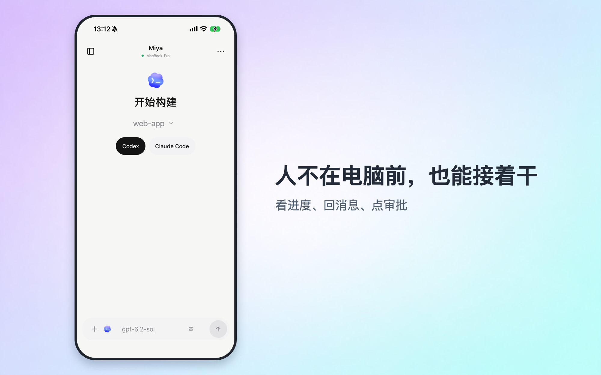
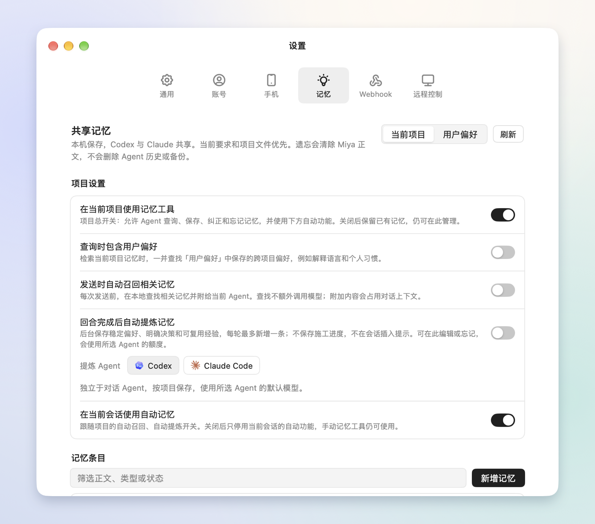

# Miya

**让 Codex 和 Claude Code 坐到同一张桌子上干活。**

一个窗口管住所有项目和 Agent；人离开电脑，就拿手机接着看。

## 为什么做它

同时开着 Codex 和 Claude Code、跑三四个项目的时候，终端标签越开越多：哪个在等审批，哪个早就跑完了，全靠记性。想让 Claude 写、Codex 审，还得自己当传话筒，来回复制粘贴。

Miya 就是为了把这些杂事收起来：Agent 交给一个常驻后台去跑，你只在需要你的时候出现——在电脑前，或者在手机上。

## 它能帮你做什么

### 一个窗口，所有 Agent

Codex、Claude Code、Pi 放在一起用，模型、推理档位和斜杠命令都按各自的来。侧边栏一眼就能看出哪些在跑、哪些在等你点头。

### Agent 之间会自己分工

跟 Claude Code 说一句「让 Codex 审一下」，它会通过内置的 `miya` 工具把任务交过去，结果自动回到原来的对话。用 `@` 还能把另一个会话整段拿来当上下文，跨项目、跨 Agent 都行。

### 关掉窗口，活儿不停

Agent 跑在独立的后台里，切项目、关窗口都不会打断它。想让它一直跑，就把工作空间放到 Linux 服务器上（`miya -serve`），电脑和手机用连接码接进去，断开了任务也照常继续。

### 手机上接着干

扫码配对，端到端加密，不用装 Tailscale，也不用开公网端口。在手机上看进度、回消息、发图片和语音、点审批，任务做完会推送通知。macOS 14 以上还能远程看桌面、接管窗口。

### 记得你们聊过的事

Codex 和 Claude 共用同一份项目记忆：一个踩过的坑，另一个不用再踩。每条记忆都能看到来源，随时修改或删除。

### 让它按时上班

用一句话写自动化，Miya 会帮你拆成项目、Agent、触发条件和检查命令，确认后交给后台：

> 每个工作日早上 9 点检查新 Issue，修好后跑 `go test`，失败就再试两轮。

定时、文件变化、命令条件和外部 Webhook 都能触发。

还有一些小东西：菜单栏里看 Codex / Claude 套餐用量，中英双语，`⌘N` 新对话、`⌘,` 打开设置，更多见[键盘快捷键](docs/keyboard-shortcuts.md)。

## 三分钟上手

1. 在要跑任务的电脑上装好并登录 Agent CLI，比如 Codex 或 Claude Code。
2. 从 [Releases](https://github.com/daodao97/miya/releases) 下载 Miya，打开后添加项目目录，挑一个 Agent 开聊。
3. 想用手机：iOS 版可通过 [TestFlight 下载](https://testflight.apple.com/join/8uEWJnDZ)。在电脑端打开「设置 → 手机」，用手机 App 扫码。
4. 想用服务器：按 [Linux 服务器文档](docs/server.md) 部署，再从工作空间菜单添加连接码。

系统要求：macOS 13+（远程桌面需要 14+），iOS 17+。连接码等于对应工作空间的操作权限，只给自己信得过的设备。

## 文档

| 主题 | 文档 |
| --- | --- |
| 安装与升级 | [安装与后台服务升级](docs/install-and-upgrade.md) · [Linux 服务器](docs/server.md) |
| 手机与远程 | [手机功能](docs/mobile-features.md) · [多桌面连接](docs/mobile-desktops.md) · [远程桌面](docs/remote-desktop.md) |
| 协作与上下文 | [Agent 协作](docs/agent-collaboration.md) · [会话引用](docs/thread-references.md) · [共享记忆](docs/memory.md) |
| 自动化与通知 | [自动化](docs/automations.md) · [动作审查](docs/action-review.md) · [通知](docs/notifications.md) |
| 日常使用 | [菜单栏用量](docs/tray-usage.md) · [键盘快捷键](docs/keyboard-shortcuts.md) |
| 架构与扩展 | [开发指南](docs/development.md) · [Agent 适配契约](docs/agent-adapters.md) · [领域边界](docs/domain-scopes.md) · [MCP 边界](docs/mcp-boundaries.md) · [国际化](docs/i18n.md) |

## 参与开发

从源码构建（macOS / iOS / Android / Linux 服务端）、测试、隔离运行和代码结构都在[开发指南](docs/development.md)里。

遇到问题欢迎提 [Issue](https://github.com/daodao97/miya/issues)，附上平台、Miya 版本、用的 Agent 和复现步骤。贴日志前记得去掉连接码、凭据和私人对话。
