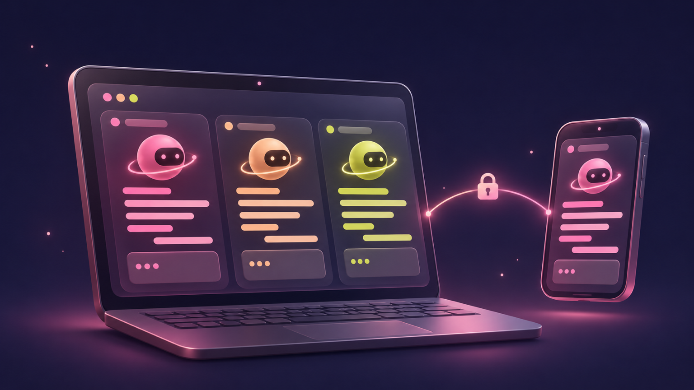
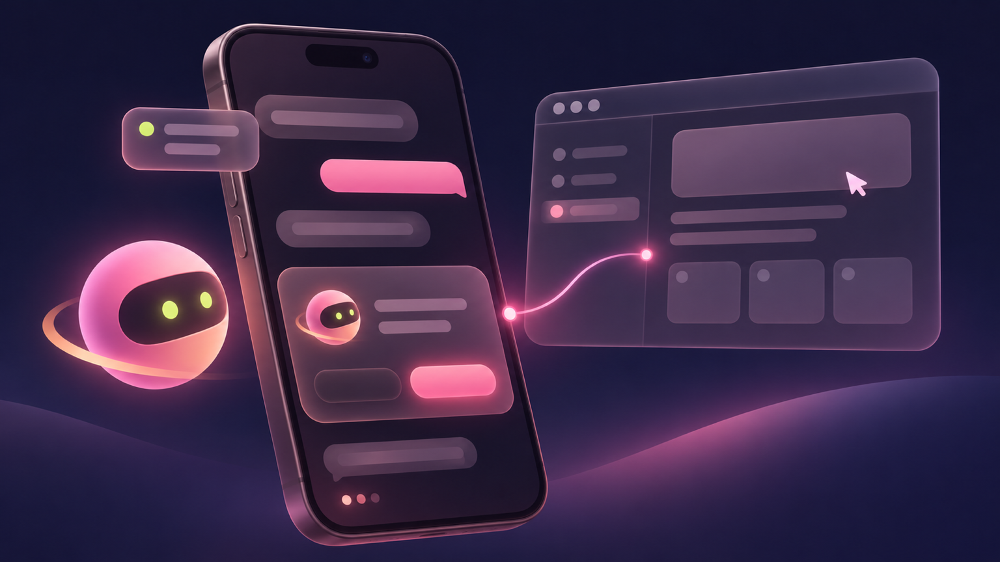
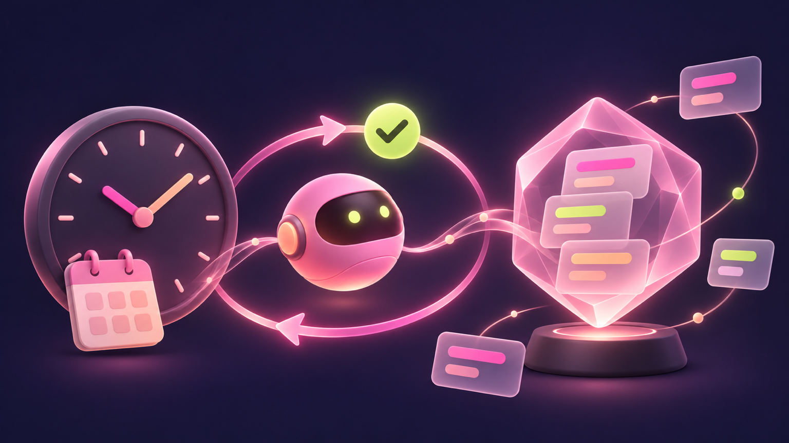
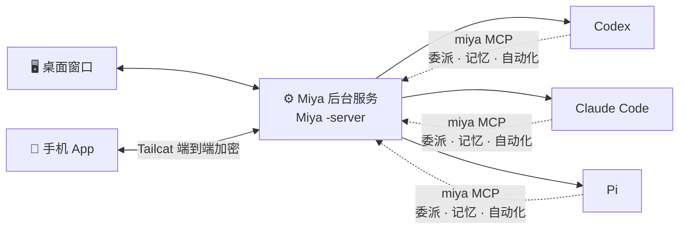

<div align="center">


# Miya

**合上电脑，Agent 接着干活。**

Miya 是一个桌面加手机的应用，用来同时管 Codex、Claude Code 和 Pi。<br/>几个项目可以一起跑，Agent 之间能互相派活，要审批的时候手机上点一下就行。

[](https://github.com/daodao97/miya/actions/workflows/package.yml)




</div>

---

## 为什么做 Miya

在终端里用 Agent 用久了，会碰到几个很具体的麻烦：

- 切到另一个项目，上一个任务就得有人盯着；
- Agent 卡在一个权限确认上，人在外面根本不知道；
- 想让 Claude Code 写、Codex 来审，只能自己在两个窗口之间来回复制。

所以 Miya 把 Agent 交给一个常驻的后台服务来管。电脑上的窗口只负责显示，手机相当于遥控器。窗口关了、人离开工位，Agent 还是在原来的项目里继续跑，该排队的排队，该等你审批的就等着。

## 能做什么

<table>
<tr>
<td width="50%" valign="top">

### 🧠 几个 Agent 放在一起用

Codex、Claude Code、Pi 都在同一个界面里，消息长得一样，模型和推理档位随时切，`/` 命令照常能用。Codex 的 Goal、Claude Code 的 Loop，还有正在跑的子 Agent，都会显示在输入框上方。

切换项目不会打断别的项目里正在跑的任务，这是我最在意的一点。

</td>
<td width="50%">


</td>
</tr>
<tr>
<td width="50%">



</td>
<td width="50%" valign="top">

### 📱 手机当遥控器

扫码配对，走 Tailcat 端到端加密直连，不用开公网端口，也不用装 Tailscale。

- 首页把所有项目的会话按「待审批 / 运行中 / 未读」分好组
- 任务跑完或者需要确认时会推送；人在电脑前由电脑提醒，离开五分钟左右才推到手机
- 能语音输入、发图片，也能同时连好几台电脑
- Agent 要你输系统授权密码时，手机可以直接接管那一个 Mac 窗口去填；需要的话也能远程操作整个桌面

</td>
</tr>
<tr>
<td width="50%" valign="top">

### ⏰ 定时任务和共享记忆

一句话就能建一个定时任务，比如：

> 每个工作日早上 9 点看一下新 Issue，能修的修掉并保证 `go test` 通过，修不过就多试两次。

到点后 Miya 会新开一个对话去做，做完跑一遍检查命令。没过就把输出贴回去让它接着改，结束后推到手机上。

几个 Agent 共用一份记忆。每条都能看到是从哪来的，记错了能改，不想要了能删。Codex 踩过的坑，下次 Claude Code 也知道。

</td>
<td width="50%">



</td>
</tr>
</table>

### 🤝 Agent 之间互相派活

每个对话里都带了 `miya` MCP 工具。Claude Code 可以把一件事交给 Codex，在另一个会话里同时做，做完结果会自动回到原来的对话，它再接着往下干。

每次委派都对应一次明确的执行。目标会话后面再聊什么，都不会改掉之前那次任务的结果。

### 还有这些

| | |
| --- | --- |
| 📊 **菜单栏用量** | 直接看 Codex / Claude 套餐还剩多少、什么时候重置，还能看出自己比匀速用得快还是慢 |
| 🔗 **会话引用** | 在输入框里 `@` 一段别的对话（可以跨项目、跨 Agent），当成上下文交给当前 Agent |
| 🖥️ **服务器版** | Linux 服务器上跑 `miya -serve`，Agent、项目、终端都在服务器上，电脑和手机随时连上去 |
| 🌏 **中英双语** | 简体中文 / English |
| ⌨️ **快捷键** | 常用操作都有快捷键，见 [keyboard-shortcuts](docs/keyboard-shortcuts.md) |

## 🏗️ 它是怎么跑起来的



其实就一个可执行文件，按三种方式启动：窗口负责显示；`-server` 是后台服务，管所有项目的 Agent、手机连接和自动化；`-mcp` 给对话里的 Agent 提供 Miya 的工具。

窗口退出不影响后台。后台要升级的话，会等手上的任务都跑完再换新版，不会把正在做的事打断。

## 🚀 上手

### 下载

去 [Releases](https://github.com/daodao97/miya/releases) 下载 macOS DMG、iOS 和 Android 安装包（由 [CI](.github/workflows/package.yml) 构建）。

用之前先在电脑上装好并登录 [Codex](https://github.com/openai/codex) 或 [Claude Code](https://docs.anthropic.com/claude-code)。Miya 直接调用你装好的 CLI 和订阅。

### 自己编译

需要 `go.mod` 里写的 Go 版本，以及放在相邻目录的 [MyGo](https://github.com/daodao97/mygo)（`../mygo`）。

```sh
git clone https://github.com/daodao97/miya.git
git clone https://github.com/daodao97/mygo.git
cd miya

./scripts/build-macos.sh                                  # macOS 桌面
./scripts/build-ios.sh -ios-team TEAM -ios-device UDID   # iOS 真机
./scripts/build-android.sh [--install]                    # Android
./scripts/build-server.sh amd64                           # Linux 服务器（arm64 同理）
```

想试新版又不想动已经装好的那份，可以用 `scripts/run-isolated.sh` 起一个隔离实例。

## 📚 文档

| 想了解 | 看这里 |
| --- | --- |
| 安装与后台升级 | [install-and-upgrade](docs/install-and-upgrade.md) |
| 服务器版 | [server](docs/server.md) |
| 手机端功能 · 多桌面 | [mobile-features](docs/mobile-features.md) · [mobile-desktops](docs/mobile-desktops.md) |
| 远程桌面与窗口接管 | [remote-desktop](docs/remote-desktop.md) |
| Agent 协作与委派 | [agent-collaboration](docs/agent-collaboration.md) |
| 自动化 | [automations](docs/automations.md) |
| 共享记忆 | [memory](docs/memory.md) |
| 通知 | [notifications](docs/notifications.md) |
| 菜单栏用量 | [tray-usage](docs/tray-usage.md) |
| Agent 适配契约 | [agent-adapters](docs/agent-adapters.md) |

---

<div align="center">

用 Go 和 [MyGo](https://github.com/daodao97/mygo) 写的，同一份代码跑在电脑、服务器和手机上。

用着顺手的话，欢迎点个 ⭐；遇到问题直接提 Issue。

</div>
