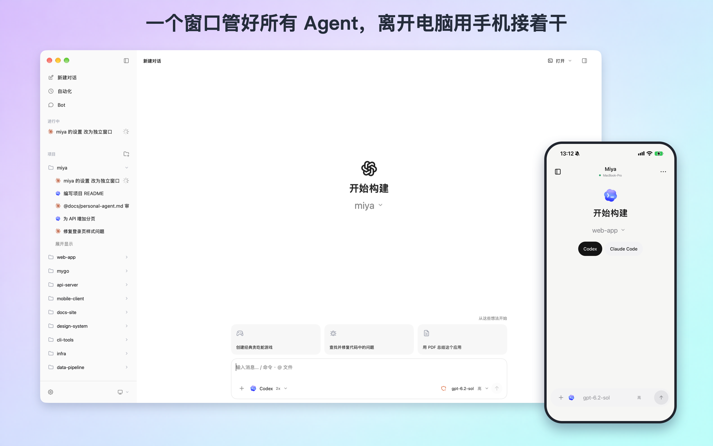

# Miya

简单克制, 刚好够用的 Agnet GUI

## 使用

1. 在要跑任务的电脑上装好并登录 Agent CLI，比如 Codex 或 Claude Code。
2. 从 [Releases](https://github.com/daodao97/miya/releases) 下载 Miya，打开后添加项目目录，挑一个 Agent 开聊。
3. 想用手机：iOS 版可通过 [TestFlight 下载](https://testflight.apple.com/join/8uEWJnDZ)。在电脑端打开「设置 → 手机」，用手机 App 扫码。
4. 想用服务器：按 [Linux 服务器文档](docs/server.md) 部署，再从工作空间菜单添加连接码。

系统要求：macOS 13+（远程桌面需要 14+），iOS 17+。连接码等于对应工作空间的操作权限，只给自己信得过的设备。

## 文档

| 主题 | 文档 |
| --- | --- |
| 安装与升级 | [安装与后台服务升级](docs/install-and-upgrade.md) · [Linux 服务器](docs/server.md) |
| 手机与远程 | [手机功能](docs/mobile-features.md) · [多桌面连接](docs/mobile-desktops.md) · [远程桌面](docs/remote-desktop.md) |
| 协作与上下文 | [Agent 协作](docs/agent-collaboration.md) · [会话引用](docs/thread-references.md) · [共享记忆](docs/memory.md) |
| 自动化与通知 | [自动化](docs/automations.md) · [动作审查](docs/action-review.md) · [通知](docs/notifications.md) |
| 日常使用 | [菜单栏用量](docs/tray-usage.md) · [键盘快捷键](docs/keyboard-shortcuts.md) |
| 架构与扩展 | [开发指南](docs/development.md) · [Agent 适配契约](docs/agent-adapters.md) · [领域边界](docs/domain-scopes.md) · [MCP 边界](docs/mcp-boundaries.md) · [国际化](docs/i18n.md) |

## 参与开发

从源码构建（macOS / Windows / iOS / Android / Linux 服务端）、测试、隔离运行和代码结构都在[开发指南](docs/development.md)里。

遇到问题欢迎提 [Issue](https://github.com/daodao97/miya/issues)，附上平台、Miya 版本、用的 Agent 和复现步骤。贴日志前记得去掉连接码、凭据和私人对话。
