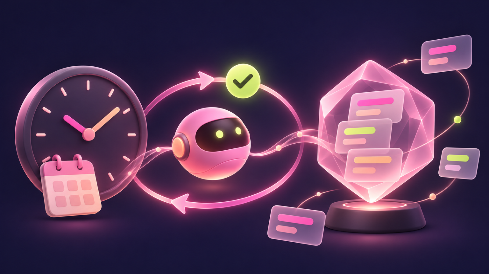
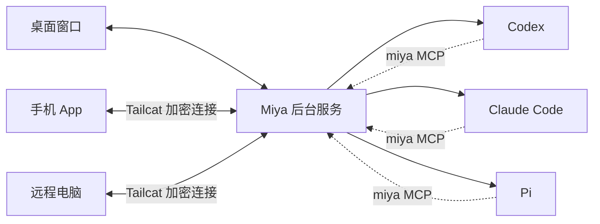

<div align="center">


# Miya

**在电脑和手机上管理你的 AI 编程 Agent。**

Miya 把 Codex、Claude Code 和 Pi 放进同一个工作台。<br/>
多个项目可以同时运行，Agent 可以互相委派任务，你可以在手机上查看进度、回复和审批。

[](https://github.com/daodao97/miya/actions/workflows/package.yml)


</div>

## 为什么做 Miya

同时用几个 Agent 做不同项目时，终端窗口、会话历史和权限确认很容易散落各处。让 Claude Code 写代码、Codex 审查，还需要自己转交上下文和结果。

Miya 用独立后台管理项目和 Agent 进程。切换项目或关闭桌面窗口不会中断后台任务；需要你处理时，可以从电脑或手机接着操作。任务仍依赖运行它的电脑保持唤醒和联网。需要长期运行时，可以把工作空间放在 Linux 服务器上。

## 主要功能

### 多 Agent、多项目

- 在同一个界面使用 Codex、Claude Code 和 Pi，按各自能力选择模型、推理档位和斜杠命令。
- 多个项目同时运行，查看会话进度、工具调用、审批和原生任务状态。
- 用 `@` 引用其他会话，支持跨项目、跨 Agent 提供上下文。
- 通过内置 `miya` MCP 委派任务，结果自动回到发起对话。


### 手机接续工作

桌面与手机通过 Tailcat 配对，使用端到端加密连接，无需安装 Tailscale 客户端或开放公网入站端口。

- 查看运行中、待审批和未读会话，回复消息、发送图片或语音输入。
- 接收任务完成和审批通知，同时连接多台电脑。
- 在支持的 macOS 设备上远程查看桌面或接管窗口。远程桌面需要 macOS 14 及以上，并授予对应系统权限。


### 自动化与共享记忆

用自然语言起草自动化，再确认项目、Agent、触发条件和检查命令。支持定时、文件变化、命令条件和外部唤醒。例如：

> 每个工作日早上 9 点检查新 Issue，修复后运行 go test，失败时再试两轮。

后台负责触发任务、执行检查并记录结果。共享记忆让不同 Agent 复用项目经验，每条记忆都可以查看来源、修改或删除。



### 远程工作空间

Linux 服务器运行 `miya -serve` 后，电脑和手机可通过连接码接入。Agent、项目文件和终端都在服务器上运行，客户端断开后任务继续执行。桌面端可以切换本机和多个远程工作空间。

此外，Miya 提供 Codex / Claude 套餐用量展示、菜单栏入口、中英双语和[键盘快捷键](docs/keyboard-shortcuts.md)。

## 开始使用

### 安装与首次运行

从 [Releases](https://github.com/daodao97/miya/releases) 查看已发布的安装包，也可以从 [Package 工作流](https://github.com/daodao97/miya/actions/workflows/package.yml) 获取构建产物。具体平台产物和签名方式见[打包配置](.github/workflows/package.yml)。未配置 iOS 分发签名时，CI 生成的是模拟器应用。

1. 在运行任务的电脑上安装并登录需要使用的 Agent CLI，例如 Codex 或 Claude Code；使用 Pi 时也需配置对应 CLI 和模型凭据。
2. 打开 Miya，添加项目目录，选择 Agent 后开始对话。
3. 需要手机接入时，在桌面「设置 → 手机」显示二维码，用手机端配对。
4. 需要接入服务器时，按[服务器部署文档](docs/server.md)安装，再从工作空间菜单添加连接码。

macOS 桌面最低要求为 macOS 13，iOS 最低要求为 iOS 17。连接码允许已配对设备操作对应工作空间，应只交给可信设备。

### 从源码构建

需要 Git、[go.mod](go.mod) 指定的 Go 1.27.3 或兼容的更新工具链，以及 Python 3。各平台还需准备对应的构建环境。

```sh
git clone https://github.com/daodao97/miya.git
cd miya
go mod download
```

项目使用 Go 和 MyGo。`go.mod` 已固定 MyGo fork 的版本，普通构建会自动下载依赖，无需另外克隆 `../mygo`。

#### macOS

在 Mac 上运行：

```sh
./scripts/build-macos.sh
```

脚本默认构建本机架构，输出 `build/darwin-<架构>/Miya.app`，不生成 DMG。也可以指定平台：

```sh
./scripts/build-macos.sh -platform darwin/arm64
```

本地默认使用 ad-hoc 签名；需要固定开发签名时，设置 `MIYA_SIGNING_IDENTITY`。安装或覆盖旧版本前，按[安装与后台服务升级](docs/install-and-upgrade.md)完成验签、备份、窗口重开和后台版本核验。

#### iOS

需要 macOS 和 Xcode。先构建模拟器版本：

```sh
MIYA_IOS_PLATFORM=ios/simulator ./scripts/build-ios.sh
```

真机构建需要配置自己的 Apple 开发团队、签名证书和 provisioning profile，再执行：

```sh
./scripts/build-ios.sh
```

#### Android

需要 JDK 17、Android SDK 和 NDK，并配置 `ANDROID_HOME`。CI 使用的 NDK 版本见[工作流](.github/workflows/package.yml)。

```sh
./scripts/build-android.sh
# 构建后通过 adb 安装并启动到已连接设备：
./scripts/build-android.sh --install
```

脚本构建 arm64 APK，输出到 `build/android*/`；未配置 keystore 时使用调试签名。

#### Linux 服务端

```sh
./scripts/build-server.sh amd64
# ARM 服务器：
./scripts/build-server.sh arm64
```

产物位于 `build/server/linux-<架构>/`，包含二进制、安装脚本和校验文件，同时生成 `.tar.gz` 压缩包。服务端不需要图形会话，部署、配对和 systemd 管理见[服务器文档](docs/server.md)。

## 开发

### 测试与隔离运行

```sh
go test ./...
```

在 macOS 上可用隔离实例验证界面和后台，不覆盖已安装应用：

```sh
./scripts/run-isolated.sh
./scripts/run-isolated.sh status
./scripts/run-isolated.sh stop
```

隔离实例默认把 Miya 数据写入 `~/Library/Application Support/Miya-dev`，但仍共享 `~/.codex` 和 `~/.claude`。不要在两个实例中同时打开同一个 Agent 对话。更多说明见[独立验证](docs/install-and-upgrade.md#独立验证不覆盖已安装应用)。

### 运行架构



同一个可执行文件承担不同入口：

| 入口 | 职责 |
| --- | --- |
| 默认启动 | 显示桌面窗口并连接后台 |
| `-server` | 由本机窗口管理的后台服务 |
| `-serve` | 持续运行的无界面服务器 |
| `-mcp` | 为 Agent 提供委派、记忆、自动化等工具 |

窗口、后台和 MCP 是独立进程。替换应用文件后，运行中的后台不会立即变成新版；新窗口会安排旧后台在空闲后退出并重连。不要通过批量结束 Miya 进程来升级。

### 代码导航

| 目录 | 内容 |
| --- | --- |
| `internal/agent/` | Agent 契约、适配器和原生协议 |
| `internal/controller/` | 工作空间、业务调度和组件组装 |
| `internal/service/` | 前后台协议、客户端、服务端和工作空间连接 |
| `internal/desktop/`、`internal/mobile/` | 桌面与手机界面 |
| `internal/chat/`、`internal/ui/`、`internal/widgets/` | 会话展示与共享界面组件 |
| `internal/remote/`、`internal/phone/` | 加密连接与手机通信 |
| `internal/automation/`、`internal/delegation/`、`internal/memory/` | 自动化、任务委派和共享记忆 |
| `locales/` | 多语言文案 |
| `scripts/`、`tests/` | 构建脚本和测试 |

## 文档

| 主题 | 文档 |
| --- | --- |
| 安装与升级 | [安装与后台服务升级](docs/install-and-upgrade.md) · [Linux 服务器](docs/server.md) |
| 手机与远程操作 | [手机功能](docs/mobile-features.md) · [多桌面连接](docs/mobile-desktops.md) · [远程桌面](docs/remote-desktop.md) |
| 协作与上下文 | [Agent 协作](docs/agent-collaboration.md) · [会话引用](docs/thread-references.md) · [共享记忆](docs/memory.md) |
| 自动化与通知 | [自动化](docs/automations.md) · [动作审查](docs/action-review.md) · [通知](docs/notifications.md) |
| 日常使用 | [菜单栏用量](docs/tray-usage.md) · [键盘快捷键](docs/keyboard-shortcuts.md) |
| 架构与扩展 | [Agent 适配契约](docs/agent-adapters.md) · [领域边界](docs/domain-scopes.md) · [MCP 边界](docs/mcp-boundaries.md) · [国际化](docs/i18n.md) |

遇到问题可提交 [Issue](https://github.com/daodao97/miya/issues)，附上平台、Miya 版本、使用的 Agent、复现步骤和相关日志。分享日志前请移除连接码、凭据和私人对话内容。
