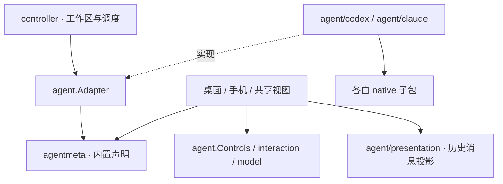

# Agent Adapter 契约

Miya 的桌面和手机按统一契约使用 Agent。Agent 的模型、命令和运行能力可以不同，界面根据能力和元数据展示，不按 Codex、Claude Code 的 ID 分派行为。

本设计参考本地 `codex-host`（`25edfd8b`）的 [`HarnessAdapter` / `HarnessSession`](https://github.com/daodao97/codex-host/blob/25edfd8b/packages/harness-adapter/src/text-session.ts)：适配层处理原生语义，Host 使用公共数据和操作，Renderer 不导入原生 SDK。Miya 沿用现有会话快照和服务传输，没有另建事件总线或动态插件系统。

## 依赖与职责

- `internal/agent.Adapter` 定义会话发现、历史加载、发送、停止、归档、删除、挂起、重发、插话、运行快照和类型化交互响应。接口不接收 `*Controller`，也不导入原生客户端或界面包。
- `internal/agent.Controls` 是界面使用的较小接口，包括状态、模型、推理档位和命令目录。设置是已经绑定工作区的 `agent.Setting`，无需再包装一组回调。
- `internal/agent/codex` 和 `internal/agent/claude` 保存具体 Adapter。原生客户端、进程协议及历史解析分别位于各自的 `native/` 子包。发送、恢复、停止、归档、重发、插话、流事件归并、请求解析和响应编码由对应实现负责。
- `Controller.Adapters()` 只组装绑定本工作区的实现。`agent.Workspace` 提供会话存储、调度、记忆与队列，`agent.Executions` 提供任务协调；各实现的 `Host` 扩展声明自己需要的连接状态与应用服务。实现包不导入 Controller、桌面、手机或 appmodel。窗口设置和运行状态不会通过全局 Adapter 对象共享。
- 连接、账号服务、目标任务和跨项目目录仍由现有应用服务管理，通过 Host 桥接。原生会话与这些应用服务的协调继续使用既有状态，尚未改成独立 Session 对象或动态插件生命周期。
- `internal/agentmeta` 是内置 Agent 的声明目录，集中保存稳定 ID、名称、图标、能力、命令路由、停滞提示时间和订阅配额入口。会话引用验证与界面使用同一份声明。

## 命令和模型

`Commands(project, load)` 返回 `CommandCatalog`。`load=false` 只读缓存，供草稿样式计算；`load=true` 可以启动原生命令发现。`Known` 区分“目录为空”和“目录尚未加载”，`Native` 表示除 Miya 自己的控制命令外，其他斜杠命令交给 Agent。合并目录时 Miya 控制命令优先，名称忽略大小写去重。

桌面根据目录过滤和路由命令，不判断具体 Agent。手机读取服务端下发的 `AgentOptions` 和目录，命令请求、响应及缓存都包含 Agent ID；同一项目的不同 Agent 不会共用命令缓存。旧版未带 ID 的命令响应仍按原有 Claude 原生命令目录解释，这个兼容规则集中在声明层。

`ModelOptions()` 由各 Adapter 生成模型标签、可用推理档位和默认档位。手机协议层只转换和校验公共选项，不再读取 Codex 模型结构或对 Claude 做特判。

## 消息和交互

`model.MessagePresentation` 描述正文、活动标题、图标、文本格式、文件变更和计划步骤。新接入可以直接提供它。既有快照里的原生 Item 和 Claude 命令封套由 `internal/agent/presentation` 投影；视图不解码它们。原生字段继续用于持久化和执行，避免重写现有历史。渲染一条活动时复用同一份投影，复制和编辑也使用已规范化的正文。

`interaction.Request` 描述审批、问题、表单和桌面接管，`interaction.Response` 描述允许、拒绝、取消、提交和跳过。桌面经 `Host.Answer` 调用 Adapter；手机发送同一类型化响应，服务端先执行共享校验，再交给 Adapter 编码。各 Adapter 保留自己的原生响应语义。Codex 包保留原有类型名作为原生 API 的兼容别名，类型定义与表单校验归公共契约所有。

现有 JSON 字段和协议版本保持兼容，新增字段均为可选。新手机同时发送旧响应载荷，旧后台仍能处理；新后台继续接受旧手机的响应。原有请求未提供新增元数据时，其 JSON 和审批指纹不变。审批内容或显式类型变化仍会改变指纹，防止对过期内容确认。

## 接入与验证

新增内置 Agent 时，在 `internal/agent/<name>` 实现公共 `agent.Adapter` 和所需的 Host 端口，再增加声明与工作区绑定工厂，输出公共会话数据、模型选项、命令目录和交互。能力缺失应如实声明；不要为统一外观伪造模型、配额或原生命令。若原生快照需要额外解码，放在适配或消息投影层。桌面、手机、共享视图和通用控件不需要增加 Agent ID 分支。

`TestViewsDoNotKnowAgents` 解析所有视图源文件及公共 Adapter 包的 Go 语法，禁止导入原生客户端、Controller，禁止具体 Agent 常量与协议路由值。`TestAgentImplementationsDoNotImportControllerOrViews` 检查具体实现的依赖方向。契约测试以第三种 Agent 检查桌面命令路由、手机目录和规范化工具渲染，并覆盖工作区隔离、类型化审批校验及旧 JSON 指纹。原有双端布局、交互与协议测试继续保留。

## 本轮验证

- 全量竞态回归：1241 项通过、26 项跳过；随后对最终命令状态展示及兼容细节的定向竞态回归通过。
- `go vet ./...` 通过；核心 Adapter、Host 与契约测试的 `gopls check` 无诊断。
- macOS arm64、iOS arm64 模拟器构建通过；Linux amd64、Windows amd64 交叉编译通过。
- 真实模型、真实远端、可选快照和设备测试仍按原有环境开关跳过。本轮未安装应用或切换生产后台。
