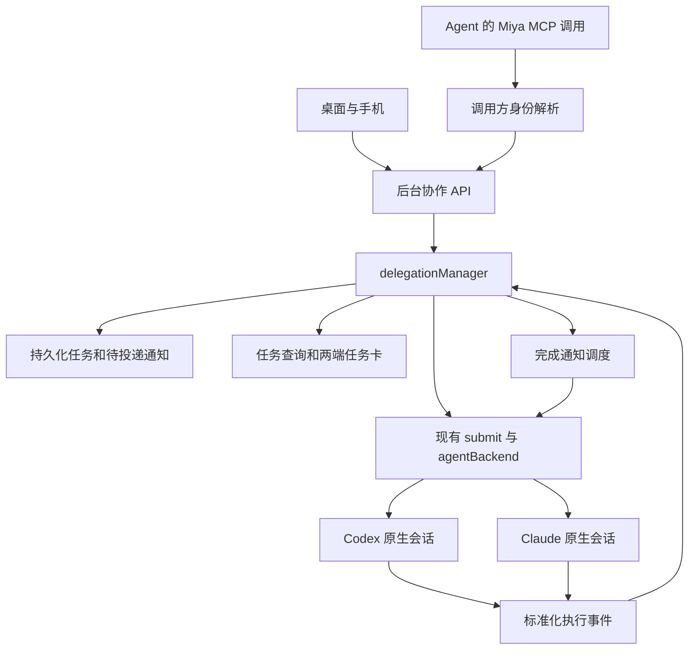

Title: 让不同 Agent 在独立会话中并行执行任务并向发起会话回传结果

当前跨模块测试入口为 `go test ./tests/integration`；下文历史验收记录保留当时的根包命令。界面包边界见 [桌面、手机与控制器边界](ui-boundaries.md)。
Author(s): Miya maintainers / Codex
Last updated: 2026-11-05
Discussion: 跨 Agent 协作设计；现有引用行为见 [会话引用](thread-references.md)，实施与验收见本文 Implementation
Status: Draft

## Abstract / 摘要

我们扩展 Miya 已有的 MCP 委派能力，让 Codex、Claude Code 和后续接入的 Agent 在独立原生会话中并行执行任务。后台服务新增持久化的委派任务记录，负责调用方识别、执行绑定、结果归档和完成回传。桌面、手机与 Agent 使用同一套后台能力，窗口关闭或切换项目不改变执行归属。

核心承诺是：**每次委派都对应一次明确的执行；目标会话后来的聊天不能改变旧任务的状态和结果。** 创建操作接受任务后立即返回，调用方可以继续工作；选择完成回传时，后台在接收会话允许继续后启动新一轮通知。原生进程、模型、权限和会话历史继续由现有 Agent 适配器管理。

本设计第一版覆盖同一 Miya 后台实例中的跨 Agent 协作，包括远程工作空间内的 Codex 与 Claude；不包含不同 Miya 实例之间的委派、自动合并代码或自动创建 Git worktree。

本文定义第一版的目标行为，交付范围为 P0–P3；P4 是后续可选扩展。工作区中存在部分实现不代表这些承诺已经通过验收，实施状态与验证缺口在 Implementation 中单独记录。

## Background / 背景与动机

### Miya 已经能够委派任务

现有 [agentBackend](../internal/controller/agent.go) 提供 Agent 注册、创建、发送、停止和恢复操作。[internal/mcpserver](../internal/mcpserver/mcpserver.go) 暴露 `list_threads`、`read_thread`、`thread_status` 和 `delegate`；[mcp_host.go](../internal/controller/mcp_host.go) 在后台调用 `submit`，向新会话或已有会话发送任务。[handoff.go](../internal/controller/handoff.go) 在发起方显示交接活动并跟踪目标进度。

[后台服务](../internal/svcproto/svcproto.go) 持有 Codex app-server、Claude 执行进程和项目会话，窗口只镜像状态。现有架构已经支持多个会话执行，无需另建进程管理器。[ThreadRef](../internal/model/ref.go) 还提供来源、后端、原生会话 ID 组成的稳定身份。

### 改造前的记录混用了会话身份和任务边界

改造前的 `mcpCaller()` 遍历正在执行的同名工具调用，选择 `StartedAtMs` 最新者。两个会话同时调用 `delegate` 时，工具名称和时间不足以证明调用方身份。以下问题说明改造动机，不作为当前实现进度的描述。

`handoffState()` 从目标会话最后一个用户消息之后提取回复。假设 A 委派 B 审查兼容性，B 完成后用户在 B 询问测试问题，A 原来的交接卡片可能随 B 的新一轮改变。`thread_status` 同样围绕会话最新回复，无法固定到委派接受的执行。

`handoffs` 和 `delegationParent` 保存在 controller 内存并使用本地数字编号，不能承担跨重启的任务关系。`delegate` 默认等待 300 秒；主 Agent 顺序调用多个委派时，前一个等待会推迟后续任务启动。

另一个约束来自 [queue.go](../internal/controller/queue.go)：普通排队消息会合并为下一轮输入。两个需要分别验收的委派不能被这种合并改变执行边界。

## Design / 设计

### 用户可以派发多个任务并选择完成后继续

例如用户在 Codex 会话中要求：

> 让 Claude 审查兼容性，再开一个 Codex 检查测试覆盖。我继续整理文档，完成后告诉我。

主 Agent 连续调用两次创建工具，各自取得 TaskID。后台创建两个独立会话，分别启动执行。主会话显示两个任务卡，Agent 可以继续工作或结束回复。子任务完成后，后台保存固定结果；选择完成回传的任务还会通知主会话，在它允许继续时启动新一轮。

目标会话是普通原生会话。用户可以打开、查看、续聊；续聊创建新的执行，旧委派卡片仍保留原结果。

| 回传方式 | 行为 |
| --- | --- |
| 仅记录结果 | 更新任务卡，用户或 Agent 按需读取 |
| 完成后继续 | 保存结果，并向发起会话投递一次通知 |

新委派默认采用 `notify: on_finish`，完成后由后台唤醒发起会话，主 Agent 读取固定结果、评估发现并继续用户原任务。显式选择 `notify: none` 才仅记录结果。主 Agent 仍在当前轮主动等待时持续调用有界 `wait_task`；若已在本轮取得结果并开始处理，应撤销尚未提交的完成观察，避免额外续轮。注册时就明确自动续轮行为，任务完成时不再增加确认步骤。

### 协作逻辑由后台服务统一持有



`delegationManager` 管理任务、去重、调度、结果、通知和恢复，不解析具体 Agent 的原生报文。具体启动、恢复、取消和事件解释仍放在各 Agent 适配代码。

会话检查、目标预留与原生状态投影由现有后台 executor 串行处理；任务状态事务和文件写入由独立的协作 worker 按序完成。两者通过不可变请求、快照和完成回调交接，不共享可变 map。后台 executor 不同步等待协作 worker，worker 等待 executor 回调时也不能持有后者需要的锁。原生 RPC 与有界等待不阻塞这两个串行队列，复用 [service.request](../internal/controller/service_server.go) 已有的 `deferred` 模式，保持手机心跳、审批和停止可用。

### 会话身份和任务身份分别记录

会话继续使用既有规范链接：

```text
miya://<source-id>/thread/<backend>/<session-id>
```

新增 TaskID 表示一次委派请求，并作为该次受管执行的 ExecutionID。后续向相同会话发送另一个任务，生成新的 TaskID。第一版不额外引入与之同义的 RunID。

以下类型表达字段归属，实际 Go 字段与 JSON 名称在实现时统一：

```go
type DelegationTask struct {
    ID        string
    RequestID string

    FromThread ThreadRef
    ToThread   *ThreadRef // 原生会话创建成功前为空

    ParentTaskID   string // 当前执行派生的嵌套任务
    PreviousTaskID string // 同一目标的后续任务

    Agent     string
    Workspace string
    Title     string
    Prompt    string
    ContextSnapshot string

    Model, Effort, Policy string
    State, WaitCause     string
    CancelRequested      bool
    Resolution           string // 空或 abandoned，不替代原生执行状态
    ResolutionReason     string

    NativeTurnID string
    SessionEpoch string
    Revision     uint64
    Result       *DelegationResult

    CreatedAt, StartedAt, FinishedAt time.Time
}
```

本地 `Thread.ID` 只作为当前服务进程的索引，不写入长期任务关系。原生会话尚未返回 ID 时，任务仍有稳定 TaskID；查询返回 `thread: null`，随后补齐 ThreadRef，不生成可长期使用的数字引用。

`ParentTaskID` 来自调用方当前正在执行的受管任务；普通用户会话直接创建的任务没有该字段。此外持久化会话派生关系：任务首次创建目标会话时记录“目标 ThreadRef → 发起 ThreadRef”。目标会话后来的普通续聊轮次、接收完成通知的 Delivery 轮次都不是受管任务，没有 ParentTaskID，但仍属于该会话的派生链。既有目标会话接收任务不改写已记录的派生来源，`PreviousTaskID` 也不增加嵌套深度。

任务创建时固定项目、目标 Agent、已解析的模型与权限配置。之后用户修改全局设置、改名或切换项目，不改变已接受的任务。新建目标的默认标题为“子任务名 · 发起会话名”，既有目标保留自己的名称。

持久化记录分别保存调用方显式请求的配置和首次接受时的有效配置：前者参与重试比较，后者用于实际执行。接收会话当前生效的模型、推理强度与权限也要随会话元数据恢复，不能在重启后的通知轮次中退回全局默认值。无法恢复时保持待投递并显示原因。

### 新工具以任务为单位立即返回

| 工具 | 作用 | 边界 |
| --- | --- | --- |
| `list_agents` | 查询可用 Agent 及配置能力 | 由现有注册表生成 |
| `start_task` | 创建独立会话并提交任务 | 接受后立即返回 TaskID |
| `read_task` | 读取状态、进度和结果 | 不启动执行，读取不消费结果 |
| `wait_task` | 有界等待指定任务 | 默认 30 秒，最大 120 秒，超时不取消任务 |
| `send_thread` | 向已有空闲会话提交任务 | 返回新的 TaskID，不静默排队 |
| `cancel_task` | 请求取消对应执行 | 不取消同会话后来的执行 |
| `resolve_task` | 重新核对未知执行或记录人工放弃 | 不由调用方直接填写原生终态 |
| `watch_task` | 注册一次性完成通知 | 接收方固定为已识别的调用会话 |
| `unwatch_task` | 取消尚未开始提交的通知 | 不取消任务，已提交通知无法撤回 |
| `list_tasks` | 查询发起或接收的任务 | 状态过滤和游标分页 |

创建请求示例：

```json
{
  "request_id": "compat-review-01",
  "agent": "claude-code",
  "title": "兼容性审查",
  "task": "审查当前修改，重点检查协议兼容、升级行为和错误恢复。给出文件位置与验证建议。",
  "context": "none",
  "notify": "on_finish"
}
```

接受响应示例：

```json
{
  "task_id": "task-<opaque-id>",
  "state": "starting",
  "thread": null,
  "notification": "watching"
}
```

响应确认任务意图已保存，不承诺原生执行已经开始。非嵌套的新建任务额度不足时返回 `queued`；嵌套创建和向已有会话提交任务在额度不足时返回 `QUOTA_EXHAUSTED`，不接受成 queued。身份、参数、Agent 或权限配置不合法时，在接受前返回错误。

新接口默认继承发起会话的项目目录。`agent` 使用 `list_agents` 返回的规范 ID（如 `codex`、`claude-code`）；省略时与现有 `delegate` 一致，使用调用方自己的 Agent。现有 `delegate` 已通过 `normalizeAgentID` 拒绝未知值，但它最终调用的 `submitExpanded` 仍经 `backendFor()` 把未知值退回默认 Agent。新入口必须在接受前完成注册表校验，受管提交函数不能依赖这条回退。模型和推理强度按目标 Agent 的能力校验，不复制另一 Agent 不兼容的模型名称。

`send_thread` 的目标参数使用完整 ThreadRef。目标忙碌或正在启动时返回 `THREAD_BUSY`；历史未加载时返回明确的加载状态或可重试错误，不通过 Claude 原有的自动入队路径接受任务。检查和目标占用预留必须在同一次 executor 操作中完成。协作额度已满时同样立即返回 `QUOTA_EXHAUSTED`，不进入 queued，也不在等待额度期间预留目标会话，避免与用户在该会话的手动输入冲突。

既有会话的 Agent 以目标 ThreadRef 为准，不能由参数切换后端；目标属于其他项目时明确拒绝，不沿用调用方目录偷偷执行。`previous_task_id` 只关联同一目标上调用方可见的旧任务，不改变权限或执行归属。目标存在活跃 Goal、Loop、待续轮的原生子任务或未核对提交时同样拒绝接受，防止原生自动续轮与受管执行争用目标。

`read_thread` 继续读取会话摘要；`read_task` 读取固定执行的结果，不改变现有摘要接口的含义。新工具的结构化输出包含 `task_id`、`state`、`thread`、`revision` 和结果可用性，供模型直接使用。`read_task`、`wait_task` 与 `list_tasks` 只对任务的发起会话、目标会话及其派生链上的祖先会话可见；同项目的其他会话需要通过桌面或手机界面查看。

可见性不等于处置权限。Agent 的 `cancel_task` 和 `resolve_task` 只允许原任务发起会话调用；`watch_task`、`unwatch_task` 只修改调用方自己的观察。已认证的桌面与手机用户可以管理本实例任务，但客户端不能把用户管理权限转交给模型填写的会话 ID。

原有 `delegate` 保留默认等待 300 秒及 `include_context` 默认开启的行为，内部改为创建或提交任务，再按返回的 TaskID 等待。旧 `thread_status` 仍查询会话最新状态，不能冒充固定任务查询。

### 调用方必须来自原生调用证据

共享 Codex app-server 的工作目录和 MCP 进程身份不能唯一确定调用会话。新协作入口不使用 `mcpCaller()` 的时间排序，也不把模型填写的会话 ID 当作调用凭证。

第一阶段从 [mcpCallerWithArguments](../internal/controller/mcp_host.go) 抽取通用的严格匹配逻辑：

1. MCP 桥接进程保留原始工具参数，服务端严格解析并拒绝未知字段。
2. 后台按工具名称及完整参数匹配已收到的原生工具调用记录。
3. 从匹配记录取得 ThreadRef、原生 Turn 和工具调用身份。
4. 原生事件尚未到达时短暂重试，超过边界返回 `CALLER_UNAVAILABLE`。
5. 匹配到多条调用记录时返回 `CALLER_AMBIGUOUS`，不创建任务或发送通知。这也包括同一会话同一轮内参数完全相同的并行调用，与现有 `mcpCallerWithArguments` 的行为一致。

新变更类工具要求 `request_id`，不同请求使用不同值。两个会话同时派发同样正文时，独立的请求 ID 使原生参数仍可区分。相同请求重试保留 ID。严格匹配是当前可信后台内部的关联机制，不是独立的访问凭证；冲突必须显式拒绝，不能按时间消除。

只匹配当前尚未结束的原生工具调用，保留其工具调用 ID、Turn 和进程代次；已结束调用的历史记录不能为新请求提供身份。桥接等待同一工具结果期间可复用已确认的关联，不能在每次轮询时改认另一个会话。已失效的进程凭证或代次不因参数相同而重新生效。

读取操作也要满足项目和调用方范围校验。旧 MCP 连接在参数完全相同时仍可能无法区分调用方，应返回可重试歧义错误，不能为了提供读取结果猜测项目。后续精确绑定的入口可以去掉这种限制。

改造前，`list_threads`、`read_thread`、`thread_status`、Automations、`report_result` 与 `request_desktop_control` 经 `mcpCaller()` 按时间推断调用方；`list_threads` 找不到调用方时还会退回窗口当前项目。P0 把 `list_threads`、`read_thread`、`thread_status` 一并改为严格匹配。其余工具在各自文档中跟进，第一版的协作判断不依赖它们识别出的调用方。

Claude 的每个执行进程已有独立 MCP 配置，可以由后台签发绑定 ThreadRef 与进程代次的临时凭证，并通过进程环境传给 MCP 桥接。凭证不进入消息、日志和持久化任务；进程结束后失效。具体工具调用仍保留原生调用证据，防止迟到请求被接到下一次执行。

新建 Codex 会话可进一步接入原生动态工具。2026-11-04 检查的本机 `codex-cli 0.166.0` 生成协议中，`thread/start.dynamicTools` 存在，`item/tool/call` 参数包含 `threadId`、`turnId`、`callId`；同版本 `thread/resume` 参数未提供 `dynamicTools`。接入前需验证新建、恢复、历史会话与工具结果展示，不能据 schema 推定旧会话可无条件迁移。第一版不依赖这条可选路径。

### 提交去重和执行绑定发生在原生副作用之前

去重键是“发起方 ThreadRef + request_id”。相同键且标准化后的语义参数一致时返回原任务；参数不同返回 `REQUEST_CONFLICT`。任务正文、上下文选择、通知设置和显式执行配置均参与比较。请求重试优先读取已保存的任务和上下文快照，不重新读取调用方摘要后比较；省略的配置继续使用首次接受时解析的值，不因全局默认设置变化产生冲突。

该去重契约也覆盖取消、观察、撤销观察和处置。保存操作名、语义参数校验值及接受回执，键仍为发起方与 request_id；跨操作复用同一键也返回冲突。相同请求重试返回原回执，需要当前状态时另行读取任务。观察撤销后有意重新注册必须使用新 ID，迟到的旧 watch 请求不能复活已撤销观察。`recheck` 的回执只确认核对请求已接受，核对出的事实仍通过任务修订发布。操作回执与相应状态变更在同一索引事务中提交，保留期限与对应任务的去重记录一致。

不按正文和时间窗口自动合并任务。用户可以有意要求两个 Agent 对同样内容分别验证；文本相同不足以证明重复操作。

接受和启动顺序：

1. 验证调用方、目标、上下文、配置、嵌套限制及对应的额度接受规则。
2. 在 executor 内预留 request_id、目标会话和调度位置，避免并发检查通过后重复创建。
3. 生成 TaskID，保存创建意图、固定配置与可选完成观察关系。
4. 等待持久化确认后，返回已接受响应并安排原生创建或发送。
5. 原生会话身份可用时保存 ThreadRef，发起执行并绑定原生 Turn。
6. 接收启动响应与事件，更新任务状态。

创建新会话与向原生发送输入是两个副作用。可取得原生会话 ID 时先保存 ThreadRef，再发送任务；Codex 首次输入前、Claude 创建或复用进程并写入输入前都要检查已持久化的取消意图。绑定到具体 Turn 或进程执行后再次核对取消标记，避免取消发生在启动确认之前而漏停。未取得原生执行身份时，不用“停止会话最新一轮”代替精确取消。

`sendRequest` 增加可选 `ExecutionID` 和 `Origin`。委派的 ExecutionID 等于 TaskID；通知使用独立 DeliveryID。普通用户消息保持既有行为。

现有 `submit` 返回整数不能区分“已启动”“已入普通队列”和“只建了本地会话”。协作入口需要带状态的提交回执和生命周期回调，不能把返回非零直接解释为原生启动成功。可以先增加专用受管提交函数，无需一次重写所有普通聊天调用。

### 任务状态由对应执行的事件推进

```text
queued → starting → running → completed
            │          ├───→ failed
            │          ├───→ interrupted
            │          └───→ needsAttention
            ├──────────────→ failed
            └──────────────→ needsAttention
```

`queued` 表示已接受且尚未安排原生启动。`starting` 覆盖会话创建和启动确认。`running` 表示执行已开始。`completed`、`failed`、`interrupted` 是终态；`needsAttention` 表示启动或恢复结果未知，需要核对，不能直接重新执行。

等待审批、用户输入或原生子 Agent 时保持 `running`，通过 `WaitCause` 区分。`CancelRequested` 记录取消意图，只有原生终态确认后才显示已停止。明确尚未启动的 queued 任务可以直接转为 interrupted，原因注明启动前取消。

`needsAttention` 是暂停自动调度的待核对状态。可靠的原生证据可以将它恢复为 running 或对应终态；已证明启动前被拒绝时记录 failed。证据不足时不重新进入 queued，也不把人工重新派发复用成同一次任务。

处置操作在 P1 随任务工具一同提供，不等 P3 界面。`resolve_task` 支持 `recheck` 和 `abandon`，只允许用户或已识别的任务发起会话操作。`recheck` 请求后台按执行绑定读取原生证据，只有匹配该 ExecutionID、原生 Turn 或进程代次的可靠证据才能推进状态；工具不接受调用方自行指定 completed、failed 或 interrupted。

`abandon` 要求记录原因，设置 `Resolution: abandoned`，但保留 State 为 needsAttention，不伪造原生失败，不释放可能仍在运行的执行额度。它停止该任务尚未开始投递的完成观察，仅从合并通知中移除该任务的通知项，不影响其他任务；已经开始提交的通知不能撤回。对已放弃任务的 `wait_task` 立即返回 `tracking_stopped: true` 及未知执行状态，不把它当作已知终态。用户仍可按准确执行身份请求取消或重新核对。

人工放弃后到达的原生事件继续按原绑定处理，可靠终态可以补齐实际状态和结果、释放额度，但不自动恢复已停止的完成观察。是否继续跟踪属于处置选择，执行是否结束属于原生事实，两者分别持久化。

适配器向协作层提供以下事件语义，字段保留原生身份与进程代次：

```go
type DelegationEvent struct {
    ExecutionID string
    Thread      ThreadRef
    NativeTurnID, SessionEpoch string
    Kind        string // bound / started / waiting / output / terminal / uncertain
    Outcome     string
}
```

Codex 绑定原生 turnId；Claude 使用本地执行 ID、进程代次及原生结果身份。Claude 进程可因 Loop 或后台工作保持存活，因此进程退出不是唯一的轮次完成信号。内存模块关闭也不能影响执行身份，不复用可缺失的 MemoryTurnID。

Claude 在输入写入前保存目标 ThreadRef 和本次进程代次。收到带 UUID 的根 `result` 且当前轮不再等待子 Agent 时，协作 worker 先保存带校验值的有界原生终态凭据，再提交任务结果与通知。凭据包含 TaskID、目标、进程代次、根结果 UUID、状态及固定结果，不保存 reasoning 或整段原生事件。子 Agent 结果、普通进程退出或缺少根结果 UUID 的报文不生成这种凭据。

若凭据已同步、任务索引尚未提交时服务退出，重启仍先恢复为 needsAttention；显式 `recheck` 严格比对已提交的执行绑定和凭据，再由正常任务事务提交结果、创建一次通知并释放占用。缺少凭据、绑定不符、校验失败或结果过期时返回 RECHECK_UNAVAILABLE，不从 Claude 会话最新回复或仅有 `end_turn` 的历史文本推造终态。

进程创建成功或输入写入成功只说明本地提交进展，不能单独证明模型已开始执行。Claude 的 started 证据来自当前根轮次的原生活动；子 Agent 帧不能终结父任务。常驻进程跨轮复用时还需区分本轮输入与后台事件；适配器无法可靠区分时，先拒绝受管提交，不能按“当前 ExecutionID”给所有帧补归属。

完成事件可能早于启动响应到达。适配器按本次提交及原生身份暂存事件，取得启动响应后只提交匹配 Turn 或进程执行的事件；不能把目标会话任意一个完成事件绑定给待确认任务。核对成功的终态不会被迟到启动响应改回 running。重复完成事件幂等；旧 Turn、旧进程代次的输出不推进新任务。暂存超过容量或期限仍无法核对时进入 needsAttention，不能无限缓存或丢弃后猜测成功。

`cancel_task` 先保存取消意图，再在 executor 内核对任务对应的当前 ExecutionID 并调用适配器停止。旧任务卡不能取消同会话已经开始的新一轮。启动尚未确认时保留取消意图，取得身份后只取消该次执行。所有检查与事件路由覆盖后台项目，不能依赖窗口当前选中的会话列表。

`wait_task` 订阅任务修订变化，在完成、超时或连接取消时释放等待者。等待超时只返回 `timed_out: true`；调用工具的连接断开也不取消后台任务。等待沿用现有 MCP 桥接侧轮询：桥接按任务 revision 短间隔查询服务，每次服务调用都在默认 15 秒的 `serviceCallTimeout` 内返回，不新增长时间占用连接的服务操作，同连接的心跳和停止请求因此不受影响。Miya 为 Codex 与 Claude 配置的 MCP 工具超时为 1500 秒（`mcp_host.go` 中的 `tool_timeout_sec`、`MCP_TOOL_TIMEOUT`），覆盖 `wait_task` 的上限和旧 `delegate` 最长 1200 秒的等待；调整任一值时都要保持这一关系。

MCP 桥接按 JSON-RPC 请求 ID 处理 `notifications/cancelled`，stdin EOF 也结束等待观察。取消等待不调用 cancel_task；已经接受的创建与变更仍完成其持久化事务。同一连接不能同时复用活跃请求 ID，否则返回明确的协议错误。

### 结果在终态时保存为固定快照

结果包含执行状态、可用性、正文、产出引用和错误，不包含 reasoning 或整段工具输出。Codex 优先取绑定 Turn 的最后一条非空最终回复；本机 `codex-cli 0.166.0` 的真实 app-server 测试确认其 phase 为 `final_answer`，不能误写成 `final`。没有 phase 的适配器在可靠轮次终结后取该执行最后一条非空可见回复。Claude 的原生 result 仅在归属和轮次结束条件成立后使用。

```json
{
  "task_id": "task-<opaque-id>",
  "state": "completed",
  "result": {
    "availability": "available",
    "source": "final_message",
    "text": "发现两处兼容性问题……",
    "artifacts": ["docs/review.md"],
    "truncated": false
  }
}
```

运行中的结果为 pending；终态没有正文时为 unavailable。失败任务可保留本轮已有的有效输出与单独错误，不能回退到上一轮回复。文件列表也只从绑定执行中提取，不扫描整个会话的历史产出。

第一版结果文本快照上限为 256 KiB，在 UTF-8 边界截断并设置 `truncated: true`。原生完整内容仍可从目标会话查看；删除原会话后只承诺保留任务快照，不承诺恢复被截断的完整原文。摘要字段不能替代原始回复冒充完整结果。

任务正文、上下文、进度、错误和产出引用也分别设限，避免只限制结果正文却允许单条任务无限增长。第一版正文最多 1 MiB、上下文最多 256 KiB，超限在接受前拒绝；进度采用有界摘要和限频检查点，逐字输出不写任务修订。产出路径是查看线索，不能仅凭返回路径自动读写文件或授予工作区外访问。

现有 `report_result` 仍只服务 Automations。第一版不扩展它，也不要求子 Agent 额外上报才算执行结束。

原生 Goal、Loop、开发服务器和脱离进程继续由 [原生任务](native-tasks.md) 与 [会话运行态](conversation-runtime.md) 管理。委派默认跟踪本次提交的回复轮次，回复结束不表示原生长期目标或服务器结束。原生子 Agent 尚需当前轮继续收尾时，该轮仍保持运行。

### 完成通知使用独立的持久化待投递记录

创建时 `notify: on_finish` 的观察意图与任务一起保存，先注册再启动，避免子任务很快完成时错过回传。后续 `watch_task` 观察已经终结的任务时直接返回 `already_terminal` 和结果，不再发送额外通知。

观察者是已识别的调用会话，第一版不允许 Agent 任意指定另一个会话为接收者。同一任务和接收方的观察在有效期间去重。观察一次任务终态，收到后结束；没有“会话未来每轮都通知”的隐式订阅。

任务终结时保存结果和待投递通知，二者在同一持久化修订中提交。通知结构至少包括 DeliveryID、任务 ID 列表、接收 ThreadRef、状态、期限及原生提交身份。

```text
pending → submitting → delivered
   │           └─────→ needsAttention
   ├─────────────────→ cancelled
   └─────────────────→ expired
```

同一接收方当前待投递的通知可以在提交前合成一个 Delivery；一旦进入 submitting，任务集合固定，后来的通知形成下一条记录。接收方收到任务链接、执行状态和读取提示，再通过 `read_task` 获取正文。通知不代表结果正确或用户已经验收。

| 接收方情况 | 投递行为 |
| --- | --- |
| 正在执行、加载、原生任务切换或等待审批 | 保持 pending |
| 有普通用户消息排队 | 用户消息优先，不与通知合并 |
| 空闲且允许自动继续 | 预留一次受管执行并提交 |
| 用户主动 Stop | 保留结果，暂停该会话协作自动继续 |
| 只读、已删除或来源失效 | 保留结果，标明无法投递 |
| 明确在原生启动前被拒绝 | 可按有限退避重试 |
| 超时且不能证明未启动 | 标为 needsAttention，核对后再决定 |

默认待投递期限为任务终结后 2 小时，可配置，避免用户早已转去处理别的事情后接收会话仍被唤醒并消耗额度。期限过去后标为 expired，不再自动唤醒，结果卡仍可读取。该期限与任务执行时长无关，不因等待通知而停止子任务。

期限按每个任务通知项计算。合并 Delivery 不延长旧项期限，也不能因最早一项到期而丢弃较新的项；调度时只移除过期项并保留其余项。定时到期检查独立于接收方是否在线、暂停或可提交，不能只在 Claim 时清理。进入 submitting 后期限不再用于把未知提交改回 pending；已有原生副作用必须继续核对。

用户 Stop 暂停的是接收会话的协作自动继续，不默认取消全部子任务。用户可点击“继续接收结果”恢复；另提供“停止全部委派任务”。普通手动发消息不隐式恢复已暂停的协作自动继续，避免用户处理别的事情时再次被后台唤醒。

Stop 在会话 executor 内立即设置投递暂停屏障，再异步保存暂停状态；已 Claim 但尚未发出原生输入的通知也要经过第二次暂停检查。暂停落盘失败时保持本地暂停并报告存储错误。恢复操作先提交持久化状态，再解除本地屏障；恢复只作用于协作通知，不自动恢复普通用户队列，也不能因旧的通用 Stop 标记残留而一直无法投递。

自动通知不走会合并消息的普通 Queue。新增一个会话空闲调度入口，按“用户队列优先、协作通知随后”选择一次提交，并原子预留目标。通知使用目标会话当前已生效配置，不读取另一个窗口的下一条消息设置。

同一接收方最多存在一个已开始提交但尚未确认的 Delivery；其状态为 needsAttention 且尚未人工处置时也阻止后续自动通知抢先提交。明确未启动的拒绝按 1、5、30、60 秒退避，之后最多每 60 秒一次，并受原有逐项期限限制；超时或断线不能作为未启动证据。只读、已删除等不可投递原因随摘要同步，保留 pending 到期或由用户撤销，不伪造 delivered。

接收方可以通过桌面或手机的 `resolve_delivery` 用户操作停止跟踪未知通知。该操作保存 request_id 回执和原因，保留 Delivery 的原生未知状态，仅设置 `Resolution: abandoned` 并解除对后续结果的阻挡；不重发原通知、不声称已取消原生执行。旧回调可以补齐 accepted，但不会恢复已撤销观察。该处置不向模型暴露；MCP 仍不能通过请求参数取得用户管理权限。

`delivered` 表示原生已接受通知执行，不表示主 Agent 已读完或汇总成功。第一版界面只显示“结果已返回”，不推断“Agent 已处理”。撤销观察与提交在同一个 executor 上排序，进入 submitting 后取消请求返回“已开始投递”。

### 持久化记录支持核对恢复

新增 `appdir.Dir()/delegations/` 目录：`index.json` 保存 schemaVersion、revision、任务摘要、请求去重与操作回执、会话派生关系、暂停状态、观察与 Delivery；每个任务的上下文快照和终态结果保存在不可变的 `tasks/<task-id>/<task-revision>-<sha256>.json`。索引记录具体任务修订和内容校验值，加载路径只由校验后的 ID、修订和摘要生成。状态迁移只写变化任务的新修订并更新索引，不重写其他任务的大结果。消息增量及完整原生历史不复制到协作存储。

`outcomes/<task-id>.json` 只保存 Claude 适配器收到的明确终态证据，采用相同的私有权限、同步写入、原子替换和内容校验。它不是已提交任务修订，不参与自动恢复、任务接受或通知投递；只有显式核对可以使用它。凭据结果采用同样的 256 KiB 上限并保留截断标记，且随任务结果过期或任务删除清理。清理必须在相应索引提交之后，索引提交失败不能先删凭据。

文件名包含内容摘要，防止新任务修订已经写入而索引提交失败后，重启重用同一修订号却遇到不同内容的孤立文件。相同路径只允许复用相同内容，不覆盖已存在的不同载荷。

存储采用串行 writer 写临时文件、同步内容并原子替换；平台支持时同步目录。跨文件修订以索引为提交点：先写入并同步新的任务修订及其目录，再原子替换并同步 `index.json`。已被索引引用的任务文件禁止原地覆盖。任务的终态结果与 Delivery 只有在引用它们的索引修订落盘后才算提交；旧索引仍能读取完整的旧任务修订，即使新任务文件已经写入而新索引尚未提交。

恢复时只读取已提交索引指定的任务修订并核对校验值，不选择目录中编号最大的文件。未被索引引用的修订不参与恢复；旧修订仅在新索引持久化成功、且没有读者持有旧快照后清理。writer 按修订顺序处理，executor 在完成回调后释放对应副作用，不能让较旧快照覆盖较新状态。用户可见的已接受响应、自动投递和恢复调度均依赖相应持久化屏障。

文件不存在时初始化空存储；损坏或不支持的版本必须保留原文件，停止协作写入并显示错误，不能当作空任务库自动重建。写入失败时停止新的任务启动与通知投递，继续观察已经运行的 Agent，并显示存储错误。

写入故障要通过运行时健康状态同步到桌面、手机和查询响应，不能只报告启动加载错误。故障后查询仍可返回最后已提交快照，但必须附带 `storage_error` 与 `stale: true`；未落盘的终态不能宣布为已保存结果、触发通知或释放持久化占用。原生会话仍按现有路径接收事件，协作层保留有界的待核对身份和错误提示；修复后以可靠原生证据恢复，不能静默丢弃事件后继续启动。目录同步失败也属于提交结果可能未知的存储故障，恢复前不重试相应原生副作用。

第一版保留策略：终结超过 30 天的任务可删除快照文件，索引继续保留任务摘要、语义请求校验信息和 request_id 记录，并明确标记结果已过期。先提交不再引用快照的新索引，再清理文件；`read_task` 返回过期状态，不把缺失文件当作存储损坏或回退到会话最新回复。幂等保证期限与索引记录一致；索引超过 10000 条终态记录时，按终结时间删除最旧的摘要，同时失去这些 request_id 的幂等保证。这两个值都是初始配置。未完成任务、观察、待核对提交和待投递通知引用的记录不能被清除，人工放弃本身不使未知执行符合终态清理条件。

快照过期后的索引必须仍包含校验重试、展示摘要、权限判断和会话派生链所需的字段，不能只留下指向已删除文件的指针。清理任务不删除仍被后代会话使用的派生关系，否则嵌套深度和祖先权限会在 30 天或 10000 条边界后改变。永久删除去重记录前标明保证期限，过期后的客户端不能把旧 request_id 当作仍受保护的自动重试。

| 重启时状态 | 恢复行为 |
| --- | --- |
| 已终结任务 | 提供保存的固定结果或明确的结果过期状态，不重跑 |
| queued 且未发出原生请求 | 校验工作区、配置与配额后继续调度 |
| 原生身份完整 | 读取原生历史，核对绑定执行 |
| 新版 prepared 任务，能证明输入意图尚未提交 | failed，说明提交前中断并通知发起方，释放额度，不自动重跑 |
| 创建或发送结果未知 | needsAttention，不自动创建替代任务；旧 Claude 空代次记录不能推断未提交 |
| 人工放弃且原生结果未知 | 恢复 abandoned 处置与未知占用，不自动通知、不改写为 failed |
| pending 通知 | 恢复接收方暂停状态与投递期限 |
| prepared 的 submitting 通知 | 能证明未提交输入，恢复 pending 并重试 |
| 其他 submitting 通知 | 核对是否已有对应执行，不能直接重发 |

Miya 文件与原生 Agent 不共享事务。原生可能已接受请求，而服务尚未保存响应；这种窗口不能承诺绝对仅执行一次。核对必须使用原生身份或可靠的提交关联证据；时间接近、正文相同和会话最新回复都不足以证明。证据不足时保留未知，由用户检查目标后明确决定重新派发。

持久化的原生历史显示 inProgress 也不等于执行仍然存活。恢复 running 必须有当前连接或进程对准确执行身份的活跃证据；RPC 返回后应用状态前再次核对 ExecutionID、Turn 和连接代次，避免查询期间重连使证据失效。匹配身份的历史终态可以归档。Claude 的本地进程代次在重启后只能用于拒绝旧事件，不能独自证明任务完成；只有可核对的原生轮次身份与终结记录才能恢复终态，否则明确返回待核对及原因。两种 Agent 的 recheck 都是 P1 验收项，不能以读取会话最后回复补足缺失能力。

窗口重开、手机断线和项目切换不取消任务。后台升级仍遵循 [安装与后台服务升级](install-and-upgrade.md)：活跃执行、启动请求与尚未落盘的操作计入 busy；已经持久化且暂停的通知不永久阻止升级。退出前保存并停止调度，接收方的暂停选择在重启后保持。

### 上下文和权限在接受任务时明确

| 上下文模式 | 内容 |
| --- | --- |
| `none` | 自包含任务正文，新接口默认值 |
| `caller_summary` | 现有 threadPacket 生成的有界摘要 |
| 显式引用 | 按现有引用语法附加指定会话快照 |

快照在接受任务时生成。排队后不重新读取，源会话续聊、改名、分支不改变内容。上下文未加载时可以预取并返回可重试错误；不能先启动任务，再补一份来源不确定的摘要。

`@会话` 继续仅提供上下文，不向来源发送消息，也不建立委派关系。上下文是来源材料，不能替代当前任务指令或授予权限。新接口生成的任务与通知使用现有 MemoryControl 规则，避免内部控制文本被自动提取为用户记忆。

权限沿用目标 Agent 的可映射配置，不因委派自动升级到 full access。需要审批时继续通过现有桌面与手机卡片处理。某个 Agent 无法强制只读时，不能把提示词里的“只读审查”显示为已经落实的文件系统隔离。

### 调度额度和工作区范围保持明确

第一版服务级并行额度默认 4，可配置；这是待性能验收的初始产品值。额度只限制协作任务，不抢占用户手动会话，且不替代原生运行态对后台资源的管理。额度在安排原生启动之前原子预留，覆盖 starting 和 running；等待审批或子任务的父执行仍占额度，send_thread 投向既有会话的任务同样计入额度。只有可靠证据证明对应执行已结束或原生请求明确未被接受时，才能释放其额度。

needsAttention 任务的原生执行可能仍在运行，因此保留未知占用并显示原因；静默时间、请求超时和人工放弃都不构成释放依据。用户可触发重新核对或按准确执行身份停止目标，服务据实际结果释放额度。未知占用及处置在重启后恢复；第一版不提供忽略未知占用后自动超额启动的路径。

额度已满时，只有非嵌套的新建任务可以保持 queued，并立即返回 TaskID。调用方当前正在执行一个受管任务，或调用会话位于已记录的派生链中时，其 start_task 属于嵌套创建；创建者必须在接受时原子取得执行额度，否则返回 `QUOTA_EXHAUSTED`，不创建 queued 子任务。该规则同样适用于旧 delegate，防止所有父任务占满额度后又等待无法启动的子任务。ParentTaskID 的具体写入仍按当前受管执行确定，额度判断不能只检查新任务是否已生成该字段。

父任务已经记录 CancelRequested 后，新的子任务请求返回 `PARENT_STOPPING`；已接受子任务的同 ID 重试仍返回原记录。取消父任务不自动取消此前接受的独立子任务，避免把“停止继续派发”与“停止全部子任务”混为一次操作。

新建任务的 queued 状态只表示非嵌套任务的服务调度队列。已有会话的 send_thread 不提供忙碌或额度不足排队，避免任务等待期间与用户输入混合。服务串行预留与后续空闲调度共同保证一个目标一次只接受一个受管执行；待持久化接受失败时，要回滚尚未发出原生请求的额度预留。

继续保留当前两层嵌套限制。深度取两条持久化链的较大值：当前执行的 ParentTaskID 任务祖先链，以及调用会话的会话派生链。如果只按任务链计算，子会话的普通续聊轮次或父会话的通知轮次再派发时会从深度 0 重新计数，比现有按会话记录的限制还弱。拒绝向任一链上的祖先会话回派并形成递归；普通查看结果不增加深度，也不建立等待依赖。

第一版共用项目目录，任务详情明确显示实际目录。自动 worktree 后续单独设计未提交修改的快照、任务基线和结果合并；不能直接创建基于 HEAD 的 worktree 就声称子任务看到主会话正在修改的代码。

独立会话只隔离对话与执行身份，共用目录仍可能发生并发写入。任务详情明确显示共用工作区；实现不承诺文件修改串行化或冲突自动恢复。可映射的只读策略由适配器实际执行，多个可写任务的文件分工由用户或主 Agent 指定，任务完成也不自动提交或合并修改。

远程工作空间的任务在远端后台执行，路径、ThreadRef 和配额均属于远端实例。本机切换工作空间不改变任务位置。跨 source 的引用或目标返回明确错误，不转成本机同路径执行。

### 两端使用相同的任务卡和操作语义

主会话任务卡显示任务名、Agent、状态、最新进度及目标入口。完成后显示固定结果摘要；Agent 通过 `send_thread` 向原目标续派时生成新的 TaskID，旧卡仍可查看。子会话提供返回来源任务的链接。会话还没有任务时，两端都不显示任务入口；两端的“工作中”和最新一轮“已工作”共用输入框上方的状态栏，最新回复的复制和转到新会话按钮也放在同一栏，完成后显示并可直接操作。Agent 任务入口固定在右侧，窄手机上显示任务图标与数量，完整名称保留给辅助功能。点击入口后，任务列表与详情在按钮上方向上弹出，不占用聊天区或输入框的布局空间；内容过长时在弹层内滚动，点击外部或按 Esc 收起，任务刷新不会自动展开；历史回复仍保留各自耗时与操作按钮。

输入框 `@` 菜单依次列出可委派的 Agent、会话和文件；选择 Agent 插入与 `#` 相同的 Agent 标签，会话和文件仍作为引用。`#` 只列出 Agent。后台未声明协作能力时，`@` 菜单不显示 Agent。Agent 标签需要独立的结构化消息段，支持删除、复制、粘贴和草稿恢复；代码块、转义文本及已有语法继续作为普通文字。`#` 仅在行首或空白之后、且后续文字匹配 `list_agents` 中的 Agent 名称或别名时弹出选择；`#123`、Markdown 标题等不匹配的输入保持原文。桌面与手机使用相同的可往返格式和解析器，不按可见标题恢复目标 Agent。

当前格式为 `#[Claude Code](miya-agent://claude-code)`，消息段类型为 agent_ref，agent 字段保存规范 ID，titleSnapshot 保存显示名称。它能与 thread_ref、普通文字及已选择的斜杠命令同时存在；文件引用中的 `#` 不应被 Agent 补全截断。旧后台未声明能力时隐藏选择入口，粘贴已有标签后发送也返回升级提示，不把标签作为普通消息静默发出。

提交 Agent 标签时，后台给当前 Agent 附加使用协作工具的明确指令；选择标签本身不执行任务。任务只由 Agent 委派，界面不提供用户手动派发或续派；用户通过任务卡查看结果、取消、调整回传和核对执行。

原生输入的协作指令只根据当前用户消息的显式 agent_ref 段生成，不扫描上下文摘要或记忆中的标签来触发委派。指令不混入界面消息、草稿或记忆证据。MCP 初始化说明也解释同一标签格式，供原生 Goal 使用；来自代码和引用材料的标签仍不是当前用户的派发指令。

任务视图按修订同步摘要，不把整个任务存储加入每次聊天增量。详情和结果按需读取；手机断线保留已读数据，创建超时后使用原 request_id 查询或重试，不生成新 ID 自动再派。

## Rationale / 理由与取舍

### 复用 MCP 和后台 Socket 能减少执行入口

Miya 已有适配器、后台服务与 MCP，不需要照搬 codex-host 的 CLI 加本地 HTTP 控制服务。协作 API 放在已有服务中，身份、项目、审批和两端同步都能共用。未来增加 CLI 只应是同一 API 的薄封装。

### 固定任务结果比跟随会话最新回复更容易核验

会话是长期容器，一次委派是有边界的执行。固定 TaskID 后可以可靠等待、取消和重试；只保存目标 ThreadRef 再读最后一轮会把后来的用户聊天混进旧任务。原生内部子 Agent 仍用现有 SubAgent 展示，不能据此替代跨会话任务记录。

### 事件驱动适合 Miya 已有的原生连接

后台已经接收 Codex 与 Claude 的实时事件，正常生命周期直接由事件推进。恢复时按需查询原生历史，定时任务只检查投递期限与重试时间，不为了协作反复全量加载每个会话。

### 独立通知队列保留用户输入的优先级

复用普通 Queue 看似改动更少，却会把用户输入、多个委派和系统通知合成一轮，配置也可能取最后一条消息。独立投递记录需要更多状态，但能证明通知对应哪次执行，并实现 Stop 后暂停与重启核对。

### 第一版保持显式任务和有限调度

第一版不增加自动规划 DAG、任意 Agent 广播、自动共享全部历史或自动合并代码。Agent 可以通过多个 start_task 与后续 send_thread 完成协作；服务负责准确执行和返回，不替模型决定需求是否完成。

## Compatibility / 兼容性

工具能力以增量方式发布，`delegationV1` 在 wire 中表示为 `collaboration.version: 1`，包含支持的 operations、revision、storage_error 和 stale；具体状态和配置字段由任务查询与 list_agents 返回。客户端依据协商结果显示入口；旧后台不支持时显示更新提示，不把新请求回退成普通消息。当前服务与手机只增加可选字段及按能力启用的 collaboration 操作，保留 serviceVersion 2 与手机协议 5；后续如有不兼容变化，遵循现有版本拒绝机制。

旧 `delegate` 的默认等待与上下文行为保留，但调用方歧义改为拒绝，不再按时间猜测。新创建流程不改变普通聊天的排队合并；任务与通知使用新增的受管提交边界。

旧 `delegate` 没有 `request_id`。内部为每次调用生成新的 TaskID，不提供重试幂等；两个会话以完全相同的参数同时调用时会因歧义被拒绝，调用方需要错开调用或改用新工具重试。

旧 `delegate(thread_id)` 向忙碌会话隐式入队的行为收紧为返回 `THREAD_BUSY`，调用方应等待后重试。这是明确的兼容性变化，用来避免旧工具继续绕过独立执行边界；升级前已进入普通 Queue 的消息仍按旧聊天规则处理，不追认成新的持久化任务。

旧内存 handoff 没有可靠的原生执行关联，不从最后回复推造持久任务。已经运行的旧 Agent 进程继续完成现有工具调用；新进程启用新工具配置，不为更新而强杀后台或进程。

2026-11-05 修复将新委派的默认回传方式从仅记录改为完成后继续；显式 `none` 保持不变。旧请求重试按首次接受的通知选择校验，不按当前默认值重新解释，也不会复活后来撤销的观察。原有 `delegate` 保持旧等待与仅记录行为；新版 start/send 工具优先用于需要持续跟进的工作。

新增存储增加任务接受和终态落盘成本。只有状态变化和必要进度检查点写盘，逐字输出仍走现有消息增量。任务记录含有上下文与结果，使用服务数据目录的受限文件权限，不额外上传或同步到另一个实例。

## Implementation / 实现与过渡

### 当前实现与完成验收分开记录

当前工作区已有 `internal/delegation/` 状态机与存储，以及 `delegation_*.go` 的服务、MCP、原生事件和通知适配代码。这些代码仍属于第一版实施中的内容；本文的目标约定不会因为部分路径可运行而自动标为已完成。

| 交付项 | 当前进展与剩余验收 |
| --- | --- |
| 变更操作重试 | 已有同事务操作回执、跨操作 request_id 冲突校验，以及重启后旧 watch 不复活的测试；创建与变更仍共用去重命名空间 |
| 故障与保留策略 | 已有运行中 storage_error/stale、过期摘要、受保护引用、索引先提交后清理与会话派生链保留；真实平台崩溃与文件系统故障验收仍需补充 |
| 自动回传 | 已有本地 Stop 屏障、持久化暂停、显式恢复、逐项过期和拒绝退避；真实 CLI 已验证父会话忙碌时合并两个结果、空闲后仅一次原生回传并完成父会话回复 |
| 原生恢复与执行边界 | 已修正 final_answer、启动中取消、后端绑定、重查过期证据与提前事件缓存上限；Claude 已增加输入前进程绑定、根结果终态凭据与显式重启核对。未收到或未保存明确终态时仍保留未知 |
| 两端入口 | 已有共享用户 API、手机异步请求、能力/健康状态同步、#Agent 标签，以及共用的任务列表、固定结果详情、观察/撤销、取消/批量取消、核对/停止跟踪和恢复接收界面；模糊失败保留原 request_id，缓存与迟到响应按来源及会话隔离 |
| 验证证据 | 已有合成协议、故障和两端共享 API 到任务卡的联调；真实 Codex/Claude 已验证 Miya 任务并发、固定结果、Claude 终态凭据和一次合并回传轮次。另已验证真实 Claude 自主调用新版 MCP、审批、委派 Codex、等待及读取结果；两个独立测试后台间切换已验证来源隔离，跨主机链路及实机手机操作仍需单独验收 |

验收记录须注明日期、版本、命令或操作、结果和未验证项。合成子进程测试只能证明适配器在给定报文下的行为，不能替代真实 Agent 验收；文档核对也不能登记为运行验证。

2026-11-04 已执行的检查：

| 检查 | 结果与证明范围 |
| --- | --- |
| `go test ./... -count=1 -timeout=300s` | 最新全量结果 1037 项通过、21 项跳过；跳过项不能登记为已验证。完整 JSON 日志保存在 `/private/tmp/miya-collaboration-full-20261104.json` |
| `go test -race ./... -count=1 -timeout=360s` | 最新全量结果 1037 项通过、21 项跳过，无竞态报告。包含 Stop/恢复、手机状态流、损坏存储、请求去重、结果 phase、缓存溢出、进度归属、MCP 等待取消和 Agent 标签；日志保存在 `/private/tmp/miya-collaboration-race-20261104.json` |
| `go test -race ./internal/delegation` | 31 项通过，包含父任务取消后拒绝新派发、已接受子任务继续运行的边界 |
| `go vet ./...` | 通过，全项目静态检查 |
| `GOOS=windows GOARCH=amd64 go test -c ./internal/delegation` | 编译通过；未验证 Windows 上实际写盘、重启或 UI 行为 |
| `QUICKGUI_CLAUDE_LIVE_TEST=1 go test ./internal/agent/claude/native -run '^TestInstalledClaudeConversation$'` | Claude Code 2.1.316：空临时工作区、禁用工具的真实会话与恢复测试通过 |
| `CODEX_INTEGRATION=1 go test ./internal/agent/codex/native -run '^TestRealServer$'` | codex-cli 0.166.0：空临时工作区、只读沙箱中的两轮上下文测试通过，记录到 final_answer；该测试拒绝工具请求，没有验证 Miya MCP 委派 |
| Agent 标签 UI 渲染与交互 | 桌面及 320/390 宽手机输入、选择、复制和删除/撤销检查通过；已查看 `/private/tmp/miya-collaboration-ui-20261104/` 内三个截图，未见标签溢出或正文遮挡 |

本地风险复核已经据此修正原生 phase 误判、通用 RPC 错误被误当成未启动、旧 recheck 覆盖断线状态、启动中取消漏停、损坏存储下旧工具空指针，以及通知暂停和旧观察重试问题。外部独立 Agent 审查此前被自动审批拒绝，原因是该审查会把本地代码或基线发送到外部；未通过其他 Agent 绕过，不能把本地检查登记为外部审查通过。

全量竞态检查另定位到既有生命周期问题：手机重连测试恢复全局调度钩子前没有等待拨号循环退出；窗口在线状态上报 goroutine 没有随旧服务连接退出，且有独立 executor 的 controller 仍会读取全局调度钩子。已分别补齐退出同步、连接关闭监听和按实例调度，并增加回归验证；修正后的最终全量竞态检查通过，结果见上表。

2026-11-05 续做记录：

- 桌面与手机共用任务面板已接通。手机用户 API 创建任务后，桌面服务接口和手机接口返回相同的固定结果；通过实际服务数据渲染并查看 1120、320、390 宽结果卡与续派表单，截图在 `/private/tmp/miya-collaboration-ui-20261105/`。
- 修复任务详情的通知状态刷新：观察与投递状态变化不必改变任务修订，详情仍需更新；选中后续分页中的任务也继续核对。首屏有该任务时比较摘要元数据，避免无关进度变化反复拉取大结果。
- 新增 Claude 根终态凭据的崩溃窗口、子 Agent 拒绝、绑定/校验失败、幂等回放、结果截断和索引提交后过期清理验证。已通过真实 stream-json 适配器到服务重启核对的集成测试，后续普通聊天不能污染旧结果。
- `MIYA_COLLABORATION_LIVE_TEST=1 go test -json . -run '^TestInstalledAgentsCollaboration$' -count=1 -timeout=210s`：使用已安装的两个真实 CLI、空临时项目及固定标记任务，验证两独立原生会话同时执行、原生绑定、固定结果、Claude 根结果 UUID，以及父会话空闲后仅一次合并回传。日志在 `/private/tmp/miya-collaboration-live-20261105.json`。此测试从手机/共享用户 API 派发，不代表模型自主发现与调用新版 MCP 工具的验收。
- `MIYA_COLLABORATION_LIVE_TEST=1 go test -json . -run '^TestInstalledAgentCollaborationMCP$' -count=1 -timeout=210s`：真实 Claude 通过 stdio Miya MCP 自主调用 start_task、wait_task 和 read_task，委派真实 Codex，并核对固定结果。实际经过原生权限请求与 Miya 服务 respond 接口，只批准测试指定的标记任务参数；服务验证任务发起方来自该原生 Claude 会话。通过，日志在 `/private/tmp/miya-collaboration-live-mcp-20261105.json`。上述两项使用 codex-cli 0.166.0 与 Claude Code 2.1.316。
- 两条真实 CLI 流程又以 `-race` 联合执行通过，MCP 流程仍实际经过原生审批，无竞态报告；日志在 `/private/tmp/miya-collaboration-live-race-20261105.json`。
- 两个独立后台的切换测试：原后台持久化前阻塞请求，窗口切到另一来源后再返回；迟到响应保留原请求，切回原后台重试仍只有一个任务，新后台不出现任务。竞态检查重复 3 次通过。这是本地双服务协议验收，不代替真实跨主机网络检查。
- 最终 `go test -json ./... -count=1 -timeout=600s` 与 `go test -race -json ./... -count=1 -timeout=600s` 均为 1067 项通过、22 项跳过，无竞态报告。日志分别在 `/private/tmp/miya-collaboration-full-20261105.json` 与 `/private/tmp/miya-collaboration-race-20261105.json`。其后新增的 opt-in MCP 测试和双后台测试另做针对性验证；最终针对性竞态日志在 `/private/tmp/miya-collaboration-focused-race-20261105.json`。
- `go vet ./...`、临时生产构建 `go build -o /private/tmp/miya-collaboration-20261105 .`，以及 `GOOS=windows GOARCH=amd64 go test -c ./internal/delegation` 通过。Windows 仅为编译检查，未实际执行。
- 全套运行定位并修正测试夹具清理竞争：服务取消后 writer 仍可能完成最后一次终态落盘，测试必须等待它退出再删除临时目录。该 Claude 绑定测试重复 20 次通过。最初翻译目录并发更新造成的目录检查失败在最新目录中复测通过；最终全量结果以上述通过日志为准。

本轮按 review-it 的维度对未提交的协作改动做本地风险复核，接受并修正通知元数据不随任务修订刷新、重放有界结果丢失截断标记、测试取消后未等待 writer 退出三类问题；补齐了终态凭据写入失败、不可变证据、校验、保留期限和跨后台重试隔离验证。修正后的相关检查通过，未留下已确认但未修复的问题。此记录是本地复核，不替代当时尚未获得授权的独立外部 Agent 审查；之后用户明确委派的审查结果见下文。

### 按执行正确性到自动回传的顺序交付

| 阶段 | 主要改动 | 验收边界 |
| --- | --- | --- |
| P0 | 严格调用方匹配、受管执行标识、旧 delegate 按任务等待 | 并发不串调用方，续聊不污染旧结果 |
| P1 | start/read/wait/send/cancel/resolve/list、任务持久化、额度调度 | 两种 Agent 同期支持独立并行、未知处置和重启核对 |
| P2 | watch/unwatch、持久化 Delivery、会话空闲调度和 Stop 语义 | 主 Agent 结束回复后可回传，未知提交不盲目重试 |
| P3 | Agent 标签、两端任务卡和操作、能力协商 | 桌面与手机行为一致，远端任务留在远端 |
| P4 | Codex 动态工具和独立工作树 | 分别完成原生恢复与代码基线验收后启用 |

P0 与 P1 可以在同一开发阶段完成。只有单独交付 P0 时，才允许 TaskID 暂存在服务内存中，用于修正旧 delegate 的调用方识别和结果固定；服务重启或连接失效后，若原任务执行关联无法恢复，旧 delegate 的等待返回 `EXECUTION_ASSOCIATION_LOST`，说明无法确认原结果，并在已知时附目标会话链接供人工检查。不能回退到会话最新状态或回复，也不能自动重新派发。P0 与 P1 一同交付时直接使用持久化任务，不保留另一套内存任务作为正式实现。P2 必须建立在固定任务结果和持久化执行归属之上，不能先用定时发送消息模拟自动回传。

### 文件按业务职责拆分

| 文件 | 职责 |
| --- | --- |
| `internal/delegation/types.go`、`manager.go`、`events.go` | 任务类型、状态约束、创建去重、配额与执行绑定 |
| `internal/delegation/store.go`、`sync_*.go` | 版本化存储、不可变修订和平台同步 |
| `internal/delegation/delivery.go` | 观察、通知合并与持久化投递状态 |
| `internal/delegation/outcome.go` | Claude 根结果的有界终态凭据、严格绑定校验与显式核对读取 |
| `internal/delegation/coordinator` | 协作 worker、会话预留、受管提交与取消、按执行过滤的有界进度检查点、通知的会话空闲检查与原生提交，以及工具 schema、参数校验、任务列表和用户操作；经 `Host` 访问控制器 |
| `delegation_controller.go`、`delegation_host.go` | 委派参数校验与目标预留、原生回调入口，以及把后台服务控制器接成 `coordinator.Host` 的适配器 |
| `delegation_native.go` | 原生确认、轮次归属与固定结果提取 |
| `delegation_mcp.go` | MCP 入口与调用方解析、发起任务，以及 Codex 原生历史核对 |
| `delegation_api.go`、`phone_collaboration.go` | 已认证用户 API、手机异步请求与响应关联 |
| `delegation_legacy.go` | 旧 delegate 的固定任务等待与兼容处理 |
| `delegation_view.go`、`delegation_panel.go` | 两端共用的能力与健康状态、任务缓存和请求重试状态机 |
| `internal/composer`、`thread_inline_input.go` | Agent 标签、与会话引用共用的富文本对象、补全和往返格式 |
| `view_delegations.go`、`delegation_desktop.go` | 共用任务卡与表单、桌面服务接线和目标会话导航 |
| `mobile_delegations.go` | 手机异步调用、断线清理、任务面板接线和目标会话导航 |

现有 agent.go 增加可选受管提交信息，chat_events.go 与 chat_claude.go 提供执行生命周期；mcp_host.go 保留适配入口，handoff.go 改为读取 TaskID 状态。queue.go 与通知共用会话空闲调度，internal/svcproto、service_server.go 及手机协议同步能力与视图。

### 测试覆盖归属错误和副作用不确定窗口

| 场景 | 必须验证的结果 |
| --- | --- |
| 两个会话同时派相同正文 | 不同 request_id 分别归属，歧义不产生副作用 |
| 四个父任务占满额度后各自创建子任务 | 嵌套请求立即返回 QUOTA_EXHAUSTED，不接受成 queued；释放额度后的重试可启动 |
| 同时争抢最后一个额度及接受落盘失败 | 只有一个预留成功，未发出原生请求的失败接受释放预留 |
| 未知执行长时间静默及后台重启 | 持续保留未知占用，只有可靠终结或拒绝证据才释放 |
| 人工放弃未知执行后迟到事件到达 | 不伪造 failed，不提前释放额度；真实终态可补齐结果，完成观察不自动恢复 |
| 创建响应丢失后重试 | 返回原任务，参数变化报冲突 |
| watch 接受后撤销，旧请求迟到重试 | 返回原操作回执，不恢复观察；有意重订阅使用新 request_id |
| 同一 request_id 用于另一种变更操作 | 返回 REQUEST_CONFLICT，不产生副作用 |
| 目标续聊、改名或分支 | 旧结果不变，旧取消操作不停止新执行 |
| 完成早于启动响应 | 终态不被启动响应覆盖 |
| 启动响应前收到同会话另一 Turn 的完成事件 | 不提前认领为本任务结果，只接受与本次提交匹配的事件 |
| 旧进程迟到和重复事件 | 不完成新执行，不重复生成通知 |
| 启动中取消和取消后迟到确认 | 只取消原任务，等待真实终态 |
| 后台项目中的任务启动中取消 | 与前台项目行为一致，不依赖当前窗口列表 |
| 用户队列、审批和 Stop | 保持优先级，暂停后不自动唤醒 |
| Claim 后输入发送前 Stop，以及暂停后显式恢复 | 第二次检查阻止未发出的投递；恢复只解除协作暂停且不被旧 Stop 标记卡住 |
| 多个结果同时完成 | 提交前合并，提交后新结果进入下一条 Delivery |
| 合并通知中只有部分项过期，接收方暂停或离线 | 逐项过期，其余项保留；到期状态不依赖尝试投递才能推进 |
| 原生明确未接受通知及通知接受情况未知 | 前者有限退避，后者不自动重发且阻止同接收方后续抢先投递 |
| 原生接受前后服务退出 | 可确认未启动才重试，未知状态保留待核对 |
| 新任务修订已同步而索引尚未替换时退出 | 恢复旧索引及旧任务修订，不读取未提交结果，不漏建或提前投递通知 |
| 上述退出后重用修订号写入不同内容 | 不覆盖孤立载荷，按内容摘要生成新路径并提交正确索引 |
| 索引提交后清理前退出及结果到期清理 | 恢复新索引；只清理不再引用的文件，过期结果与文件损坏明确区分 |
| 结果过期后重试创建，或任务摘要达到清理上限 | 保留期内仍可校验幂等；派生链和权限不因任务清理改变 |
| P0 丢失任务关联且目标已经续聊 | 返回 EXECUTION_ASSOCIATION_LOST，不返回后续轮次结果，不自动重派 |
| 文件损坏或写盘失败 | 不清空记录，不启动未持久化副作用 |
| 执行终结时写盘失败或索引目录同步失败 | 返回最后已提交快照并明确 stale/storage_error，不漏报故障或提前释放占用 |
| 窗口关闭、跨项目和远端断线 | 后台继续执行，来源和工作目录不改变 |
| Claude 常驻进程与子 Agent | 按轮次结束，不依赖进程退出猜测完成 |
| 历史 inProgress、丢失确认的 Codex Turn 与 Claude 重启 | 区分实时证据、可靠历史终态与无法核对，不猜测 running 或完成 |
| 接收方重启后全局默认配置变化 | 通知仍使用会话已生效配置，缺失配置时不静默回退 |
| wait 超时或调用方断开 | 等待者释放，任务继续，心跳和停止正常 |

先用合成 Codex/Claude 协议和可控存储失败点验证状态机，再做真实两种 Agent 的并行派发、审批、完成通知和后台重连验收。动态工具另做新建及 resume 的原生能力验收，schema 存在不替代执行测试。

验收记录应分别报告实际执行的检查、真实 Agent 场景以及尚未验证的平台。默认并行值和结果上限是本提案的初始配置，不是已有性能结论。

## Appendix / 实现依据

- [agent.go](../internal/controller/agent.go)：Agent 注册、sendRequest、submit 与 submitExpanded。
- [internal/mcpserver](../internal/mcpserver/mcpserver.go)：既有工具定义、默认等待和 MCP 到服务的桥接。
- [mcp_host.go](../internal/controller/mcp_host.go)：调用方推断、delegate、现有嵌套限制。
- [mcp_host.go](../internal/controller/mcp_host.go)：按原生工具名称和完整参数识别调用方。
- [handoff.go](../internal/controller/handoff.go)：上下文摘要、内存 handoff 和会话最新轮次状态。
- [chat_events.go](../internal/controller/chat_events.go)、[chat_claude.go](../internal/controller/chat_claude.go)：原生轮次、消息与进程生命周期。
- [queue.go](../internal/controller/queue.go)：普通排队消息合并与 Stop 后暂停。
- [service_server.go](../internal/controller/service_server.go)、[internal/svcproto/client.go](../internal/svcproto/client.go)：executor、deferred、busy 与调用超时。
- [会话引用](thread-references.md)、[原生任务](native-tasks.md)、[会话运行态](conversation-runtime.md)、[服务器版](server.md)：稳定身份、原生长期执行与远程归属约定。
- codex-host 参考实现：`harness-delegation-coordinator.ts` 的独立会话创建、`delegation-snapshot.ts` 的执行结果投影、`delegation-watch.ts` 的一次性通知。Miya 复用其任务与通知分离的思路，具体传输与生命周期沿用本项目现有后台架构。

### 2026-11-05 独立审查后的修复

Claude 独立审查确认了续派参数、未知通知无处置出口、Codex resume 失败漏结算/污染草稿、提交前恢复过度保守及空闲全量扫描问题。本轮按实际代码与复现修复：

- 续派统一使用 `thread_id`，参数解码错误带 `INVALID_ARGUMENT`；测试经过真实用户 API 提交，不再只验证桩函数。
- 任务和通知新增可选 `submission_phase`：接受或 Claim 后为 prepared，所有原生输入路径在写入前持久化 submitting。仅能证明未提交输入的记录可在恢复时释放或重试；旧记录仍保守处理。
- Codex 在 resume 期间断线、切换连接或被拒绝时明确结算受管任务/通知，释放预留；只有普通用户输入返回草稿。
- 未知通知可由用户停止跟踪，保留未知事实并允许后续结果继续；重试、重启和迟到回调不会重发旧通知。
- 新任务默认回传，MCP 返回通知状态、接收方暂停状态和下一步动作。只读协作工具无需再次请求 Claude 权限；收到结果后继续原任务的职责写入 MCP 指引与完成通知。Stop 仍要求用户显式恢复，不由新委派静默解除。
- 空闲调度使用已发布快照的派生计数和 pending 接收方，不克隆全部历史；同一轮进度批量提交。10000 条终态记录的空闲调度回归要求零分配。实际状态变更仍有完整索引写入成本，未宣称所有写入为常数复杂度。

针对性状态机竞态回归 58 项通过；主包新增恢复、协议、默认行为和真实手机/桌面 API 操作回归通过。最终验收结果见下文。

本轮最终验收：

- `go test -json ./... -count=1 -timeout=600s`：1100 项通过、24 项跳过，日志 `/private/tmp/miya-review-fixes-full-20261105.json`。
- `go test -race -json ./... -count=1 -timeout=600s`：最终 1100 项通过、24 项跳过，无竞态报告，日志 `/private/tmp/miya-review-fixes-final-race-20261105.json`。
- `MIYA_COLLABORATION_LIVE_TEST=1 go test -race -json . -run '^TestInstalledAgentCollaborationMCP$'`：真实 Claude 派发 Codex 标记任务后结束首轮，后台完成通知自动启动第二轮，Claude 读取固定结果并完成回复；恰好一条通知，实际经过原生派发审批，后续只读结果不再需要权限接管。通过，日志 `/private/tmp/miya-review-fixes-live-continuation-20261105.json`。
- 1120、320、390 宽下，通过真实服务接口完成续派与未知通知处置，并检查截图；产物 `/private/tmp/miya-review-fixes-ui-20261105/`。`go vet ./...` 通过。
- Claude 在用户明确授权后完成独立复审：原 5 项确认解决；复审补出的受管队列边界与频繁查询全量克隆也已修复，再次复审给出 clean、无可操作新发现。最终任务 `task-5ce497194ebd8554aa3b3d7476705aea`，会话 [Claude 独立审查](miya://a1a37de5eb8f29025a00f3cdf9f301c1/thread/claude-code/662120b2-cddf-4c39-86fa-4b82fba80a84)，固定结果副本 `/private/tmp/miya-review-fixes-final-review-20261105.json`。主对话在执行期间持续调用 wait/read，取得并处理结果后撤销待提交通知，避免额外续轮。
- 额外补齐旧 outcome 规范序列化校验和兼容、Claude 失败根回复仍证明通知输入已接受的回归；phase 未提交或缺少明确证据的情况仍保持原来的保守边界。

本轮沿用两端安装授权构建并严格验签。桌面包 SHA-256 `57920641f7565ccd4495da547ed6af7fc858bf331164edd43514508f9e4281ec`，iPhone 包可执行文件 SHA-256 `b02948e541bfaee880dadb7fb1782a080659814fb8d2b0eae8628d8f0e00b584`。窗口与后台分别核验，忙碌后台按既定流程延后切换，不强杀运行中的任务。
