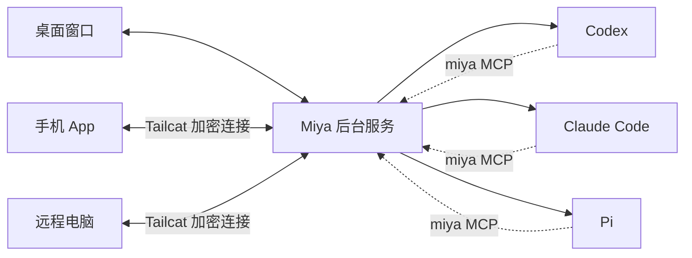

# 开发指南

从源码构建、测试、隔离运行和代码结构。使用说明见 [README](../README.md)。

## 准备

需要 Git、[go.mod](../go.mod) 指定的 Go 1.27.3 或兼容的更新工具链，以及 Python 3。各平台还需准备对应的构建环境。

```sh
git clone https://github.com/daodao97/miya.git
cd miya
go mod download
```

项目使用 Go 和 MyGo。`go.mod` 已固定 MyGo fork 的版本，普通构建会自动下载依赖，无需另外克隆 `../mygo`。

## 构建

### macOS

```sh
./scripts/build-macos.sh
# 或指定平台
./scripts/build-macos.sh -platform darwin/arm64
```

脚本默认构建本机架构，输出 `build/darwin-<架构>/Miya.app`，不生成 DMG。本地默认使用 ad-hoc 签名；需要固定开发签名时，设置 `MIYA_SIGNING_IDENTITY`。安装或覆盖旧版本前，按[安装与后台服务升级](install-and-upgrade.md)完成验签、备份、窗口重开和后台版本核验。

### Windows 和 Linux 桌面端

```sh
# 在 Windows 上构建 NSIS 安装程序
go tool mygo build -platform windows/amd64
# 在 Linux 上构建 DEB 和 RPM
go tool mygo build -platform linux/amd64
```

将 `amd64` 换成 `arm64` 可构建 ARM 版本。产物位于 `build/windows-<架构>/` 和 `build/linux-<架构>/`。MyGo 会在 Windows 上按需下载 NSIS，安装程序默认不签名。

### iOS

需要 macOS 和 Xcode。先构建模拟器版本：

```sh
MIYA_IOS_PLATFORM=ios/simulator ./scripts/build-ios.sh
```

真机构建需要配置自己的 Apple 开发团队、签名证书和 provisioning profile，再执行：

```sh
./scripts/build-ios.sh
```

### Android

需要 JDK 17、Android SDK 和 NDK，并配置 `ANDROID_HOME`。CI 使用的 NDK 版本见[工作流](../.github/workflows/package.yml)。

```sh
./scripts/build-android.sh
# 构建后通过 adb 安装并启动到已连接设备：
./scripts/build-android.sh --install
```

脚本构建 arm64 APK，输出到 `build/android*/`；未配置 keystore 时使用调试签名。

### Linux 服务端

```sh
./scripts/build-server.sh amd64
# ARM 服务器：
./scripts/build-server.sh arm64
```

产物位于 `build/server/linux-<架构>/`，包含二进制、安装脚本和校验文件，同时生成 `.tar.gz` 压缩包。服务端不需要图形会话，部署、配对和 systemd 管理见[服务器文档](server.md)。

## GitHub Actions 打包

推送代码到 `main` 或在 GitHub 的 **Actions → Package → Run workflow** 手动运行后，可从运行详情的 **Artifacts** 下载产物。推送 `v1.2.3` 这类版本标签会用标签设置版本，打包成功后生成带安装包和远程更新清单的 Release 草稿。

| 平台 | 产物 |
| --- | --- |
| macOS | Apple Silicon 和 Intel 通用 DMG |
| Windows | amd64 / arm64 NSIS 安装程序 |
| Linux 桌面端 | amd64 / arm64 DEB、RPM |
| Linux 服务端 | amd64 / arm64 安装压缩包 |
| iOS | 配置签名后生成 IPA，否则生成模拟器 ZIP |
| Android | arm64 APK |

### 发布到 TestFlight

在 **Actions → Package → Run workflow** 选择 `main`，将 `testflight` 设为 `internal` 或 `public`。这次运行只打 iOS 包，上传到 App Store Connect 应用 **Miya Agent**，并分发到对应的 **Internal Testers** 或 **Public Beta** 测试组。保留默认值 `none` 时打包所有平台。

TestFlight 使用工作流中的 `TESTFLIGHT_VERSION`（目前为 `0.1.0`）和递增的 GitHub Actions 运行编号。同一次运行重试会复用已经上传的构建。如果同版本已有构建在审核，新构建会先上传，等审核结束后重新运行失败的发布任务即可。Apple 要求审核时，公开测试任务会提交审核。

`testflight` 环境仅允许 `main` 部署，保存 `ASC_KEY_ID`、`ASC_ISSUER_ID` 和 `ASC_PRIVATE_KEY` 三项 App Store Connect API Secrets。

## 测试与隔离运行

```sh
go test ./...
```

在 macOS 上可用隔离实例验证界面和后台，不覆盖已安装应用：

```sh
./scripts/run-isolated.sh
./scripts/run-isolated.sh status
./scripts/run-isolated.sh stop
```

隔离实例默认把 Miya 数据写入 `~/Library/Application Support/Miya-dev`，但仍共享 `~/.codex` 和 `~/.claude`。不要在两个实例中同时打开同一个 Agent 对话。更多说明见[独立验证](install-and-upgrade.md#独立验证不覆盖已安装应用)。

## 运行架构



同一个可执行文件承担不同入口：

| 入口 | 职责 |
| --- | --- |
| 默认启动 | 显示桌面窗口并连接后台 |
| `-server` | 由本机窗口管理的后台服务 |
| `-serve` | 持续运行的无界面服务器 |
| `-mcp` | 为 Agent 提供委派、记忆、自动化等工具 |

窗口、后台和 MCP 是独立进程。替换应用文件后，运行中的后台不会立即变成新版；新窗口会安排旧后台在空闲后退出并重连。不要通过批量结束 Miya 进程来升级。

## 代码导航

| 目录 | 内容 |
| --- | --- |
| `internal/agent/` | Agent 契约、适配器和原生协议 |
| `internal/controller/` | 工作空间、业务调度和组件组装 |
| `internal/service/` | 前后台协议、客户端、服务端和工作空间连接 |
| `internal/desktop/`、`internal/mobile/` | 桌面与手机界面 |
| `internal/chat/`、`internal/ui/`、`internal/widgets/` | 会话展示与共享界面组件 |
| `internal/remote/`、`internal/phone/` | 加密连接与手机通信 |
| `internal/automation/`、`internal/delegation/`、`internal/memory/` | 自动化、任务委派和共享记忆 |
| `locales/` | 多语言文案 |
| `scripts/`、`tests/` | 构建脚本和测试 |
