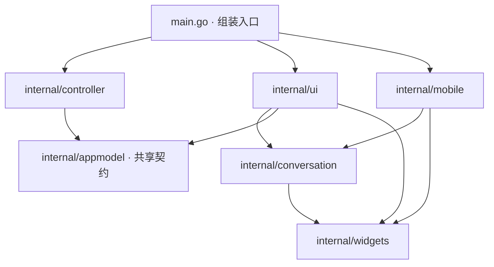

# 桌面、手机与控制器边界

根目录的 `main.go` 只选择运行入口，并注入桌面工作区的控制器工厂。原有界面和控制器已拆为独立包，构建入口仍为 `.`。



`internal/ui.Host` 描述桌面需要的操作，控制器通过结构化接口实现该契约。`Environment` 的工厂由入口注入，桌面包不导入控制器包。窗口可观察状态放在 `appmodel.WindowState` 中，界面通过 `Host.State()` 访问；Agent 后端、运行进程、会话镜像、命令缓存和引用持久化仍由控制器管理。Agent 设置及模型选择通过绑定工作区的统一 Adapter 暴露给界面，详见 [Agent Adapter 契约](agent-adapters.md)。

`internal/conversation.View` 负责消息分组、列表、Markdown、工具详情、图片、引用和富文本输入。它只要求读取当前会话、版本和审批以及重新选择会话的少量 `Host` 方法。重试、交接、用户消息编辑、记忆通知、附件粘贴和任务入口通过回调接入。桌面专属的侧栏、工作区、文件面板和设置不在共享视图中。

`internal/mobile.App` 拥有独立的 `mobileViewer`，只保存桌面下发的会话快照，不构造桌面 App 或控制器。它通过手机协议执行动作，并与桌面复用共享渲染器。两端的文件和 Web 代理位于 `internal/phoneproxy`，不依赖任一界面包。

`internal/widgets` 保存通用控件、主题、图标和设备语言处理。`internal/uiruntime` 保存窗口调度、信号失效通知与退出清理，供窗口和后台使用。各领域的数据和算法直接引用现有领域包，原有根包的兼容别名已删除。

MCP 协议和工具适配已统一到 `internal/mcp/`，Controller 通过 Host 接入，详见 [MCP 范围与边界](mcp-boundaries.md)。

## 验证

原有跨模块测试集中到 `tests/integration`，测试数据仍在根目录 `testdata/`。测试主进程以仓库为工作目录；发现端口等辅助进程保留启动者指定的项目目录。

```sh
go test ./...
go test -race ./...
go test ./tests/integration -run 'TestUIPackageBoundaries|TestViewsDoNotKnowAgents'
go test -tags miya_ios_input_test ./internal/mobile
```

`TestViewsDoNotKnowAgents` 还检查四个视图包和公共 Adapter 包，禁止具体 Agent 分支及原生客户端依赖。

`TestUIPackageBoundaries` 检查所有平台源文件的直接导入关系，阻止界面重新导入控制器、手机重新依赖桌面，以及控制器反向依赖视图。现有桌面和手机交互、布局、服务、会话引用、审批与并发测试继续运行。

实际窗口验证使用 [独立验证流程](install-and-upgrade.md#独立验证不覆盖已安装应用)，不覆盖已安装应用或切换生产后台。桌面和 iOS 构建脚本沿用原入口；嵌入的图标、Agent 图片及托盘图片随各自所属包保存。

## 2026-11-06 包拆分验证记录（Adapter 重构前）

| 检查 | 结果 |
| --- | --- |
| 全量测试、全量竞态测试 | 各 1232 项通过、26 项跳过；跳过项未计为已验证 |
| 原有根包测试迁移 | 618 个测试函数全部保留，新增包边界测试；共享视图另有独立快照 Host 测试 |
| 静态检查、原生输入测试入口编译 | `go vet ./...` 和 `miya_ios_input_test` 入口编译通过 |
| 平台构建 | macOS arm64、iOS arm64 模拟器、Linux amd64、Windows amd64 通过；后两者仅交叉编译 |
| 布局验证 | 桌面深色、手机深浅色抽屉、320/390 窄屏与大字号输入、任务栏及会话菜单测试截图通过 |
| macOS 原生窗口 | 独立应用标识和临时数据目录，验签通过；核对设置页、草稿输入和专用后台连接，随后正常退出 |

本轮没有安装到手机，也没有运行需要真实模型、真实远端或额外设备权限的可选测试。所有界面与协议回归使用原有本地夹具。
